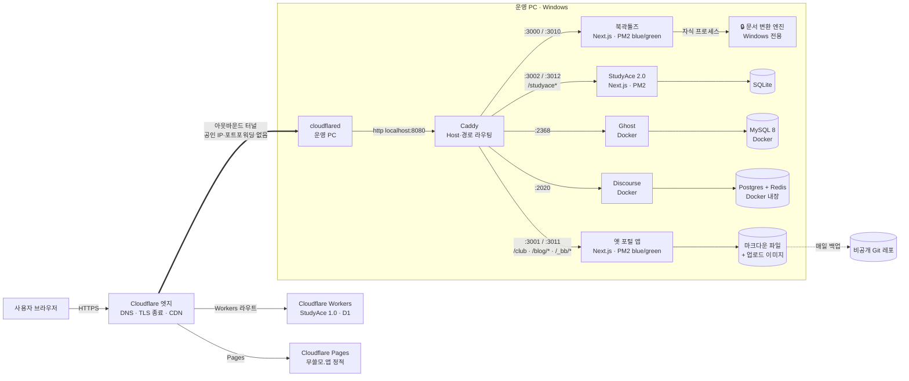

# 세미나 컨텍스트 — BinaryHub 실서비스 구조와 운영

> **이 문서의 용도**: 동아리 "개발 실무 세미나" 발표 자료를 만들 다른 세션에 넘길 배경 자료.
> **작성 기준일**: 2026-10-13
> **근거**: 레포(`bbb` 모노레포)의 실제 설정 파일·스크립트·git log, 운영 PC 의 실제 상태(PM2 목록·작업 스케줄러·이벤트 로그), 그리고 이 레포를 다룬 Claude Code 세션의 대화 기록과 그 세션이 남긴 결정 메모.
>
> **표기 규칙**
> - 표시 없음 = 파일이나 명령 출력으로 **직접 확인한 것**
> - **[추측]** = 정황상 그렇다고 보지만 직접 확인하지 못한 것
> - **확인 필요** = 레포와 운영 PC 에서 확인할 수 없는 것 (주로 Cloudflare 대시보드 설정)
> - 터널 ID·DB ID·계정 ID·이메일·API 키·비밀번호·Windows 사용자 경로는 전부 `<MASKED>` / `<TUNNEL-ID>` / `<USER>` 로 가렸다.
>
> ⚠️ **발표 제작 시 주의 — 운영자의 기존 지시**
> 운영자는 예전에 "**문서 변환이 실제로 어떤 프로그램을 띄워서 처리되는지, 어떤 도구가 브라우저에서만 도는지, 서버 PC 가 꺼지면 어떻게 되는지**는 너무 구체적이라 보안상 공개하지 말라"고 했다(사이트 공개 페이지에 대한 지시). 이 문서에는 아키텍처 설명에 필요한 만큼만 **일반화해서** 적었다. 슬라이드에 이 부분을 얼마나 드러낼지는 **운영자에게 확인**하고 정할 것. 아래에서 해당 부분은 🔒 로 표시했다.

---

## 1. 서비스 개요

**운영 주체**: 경기북과학고등학교 개발·창작 동아리 **Binary Builders (BB)**. 학생이 비공식으로 운영한다.

**도메인 하나(`binaryhub.club`) 아래 여러 서비스가 있다.**

| 서비스 | 주소 | 하는 일 | 주 사용자 |
|---|---|---|---|
| **북곽툴즈** | `binaryhub.club` (루트) | 한글(HWP)·워드·엑셀·PPT → PDF 변환, PDF 합치기/분할, 이미지 형식 변환, 서식 내려받기, 수업용 자리 뽑기 | 학생, 교사, 일반인 |
| **StudyAce** | `binaryhub.club/studyace` | 한국사·중국어 인출 학습(가림판, 응답 시간 기반 재출제) | 교내 학생 |
| **BBlog** | `blog.binaryhub.club` | 동아리 블로그(개발·연구 기록) | 일반 독자 |
| **커뮤니티** | `community.binaryhub.club` | 포럼 | 부원·사용자 |
| **무쓸모.앱** | `useless.binaryhub.club` | 농담 앱(순수 정적) | 일반 |
| 부원 블로그 | `binaryhub.club/club` | 부원 개인 블로그 (검색 제외) | 부원 |

**운영 상태 (2026-10-13 기준)**
- 전 서비스 정상 응답(200). 모노레포 첫 커밋 2026-06-03, 커밋 40개.
- **2026-10-13 구조 변경**: 그동안 루트는 동아리 포털(링크 모음)이었고 북곽툴즈는 `tools.binaryhub.club` 에 있었다. Google AdSense 심사가 루트를 보는데 포털은 본문이 549자뿐이라, **북곽툴즈를 루트로 올렸다.** 옛 `tools.binaryhub.club/*` 는 같은 경로로 301.
- 수익 모델은 Google AdSense. **아직 승인 전**(광고 단위 0개). Google 검색 색인도 도메인 전체에서 루트 1페이지뿐이라, 지금 운영의 큰 과제가 "색인·승인"이다.

---

## 2. 시스템 아키텍처

### 2.1 전체 구성도



> `study.binaryhub.club` 은 옛 Workers 판(StudyAce 1.0)이 호스트 선택 화면으로 302 를 보낸다. 지금 실사용은 `binaryhub.club/studyace` 의 2.0 판이다.

### 2.2 컴포넌트와 통신

| 컴포넌트 | 역할 | 듣는 곳 | 통신 |
|---|---|---|---|
| Cloudflare | DNS, TLS 종료, 캐시, Workers/Pages 호스팅 | 인터넷 | HTTPS |
| **cloudflared** | 운영 PC → Cloudflare 로 **바깥 방향** 터널을 연다. 들어오는 요청을 로컬로 넘김 | (포트 안 엶) | 터널 ↔ `http://localhost:8080` |
| **Caddy 2.11** | 리버스 프록시. Host 헤더와 경로로 앱 선택, http→https 301, 접근 로그 | `:8080` (평문 HTTP, `auto_https off`) | `reverse_proxy localhost:<port>` |
| 북곽툴즈 | Next.js 16 / React 19. 변환 API 포함 | `:3000`·`:3010` (blue/green) | HTTP |
| 옛 포털 앱 | Next.js 16. 부원 블로그·옛 글·로그인 | `:3001`·`:3011` | HTTP. 정적 파일은 `/_bb/_next/` |
| StudyAce 2.0 | Next.js 16.3 + SQLite | `:3002`·`:3012` | HTTP |
| Ghost 5 | 블로그 CMS (Docker) | `127.0.0.1:2368` | HTTP |
| MySQL 8 | Ghost DB (Docker, 같은 compose 네트워크) | 컨테이너 내부 `3306` (호스트에 안 엶) | MySQL |
| Discourse | 포럼 (Docker, 공식 `discourse_docker`) | `2020:80` | HTTP |
| PM2 7 | Node 앱 프로세스 관리, 재부팅 후 복원 | — | — |

- 운영 PC 의 **외부 노출 포트는 0개**다. 모든 서비스가 `localhost` 에서만 듣고, cloudflared 가 바깥으로 연결을 걸어 요청을 받아 온다.
- Ghost compose 는 `127.0.0.1:2368:2368` 으로 **localhost 에만** 바인딩한다 (`ghost/docker-compose.yml`).

### 2.3 요청 하나의 흐름 — `https://binaryhub.club/hwp-to-pdf`

1. 브라우저가 DNS 로 `binaryhub.club` 을 조회 → Cloudflare 엣지 IP. **[추측]** 터널 호스트명은 `<TUNNEL-ID>.cfargotunnel.com` 으로의 CNAME (cloudflared 표준 방식, DNS 레코드는 **확인 필요**).
2. Cloudflare 엣지가 **TLS 를 종료**하고, 이 호스트명이 터널에 연결돼 있으니 cloudflared 가 미리 열어 둔 연결로 요청을 내려보낸다.
3. 운영 PC 의 cloudflared 가 `config.yml` 의 ingress 규칙을 보고 `http://localhost:8080` 으로 넘긴다. 원래 스킴은 `X-Forwarded-Proto: https` 헤더로 붙어 온다(접근 로그로 확인).
4. Caddy 가 판단한다.
   - `X-Forwarded-Proto: http` 면 → `https://` 로 **301** 하고 끝.
   - Host 가 `binaryhub.club` 이고 경로가 `/studyace*` → StudyAce, `/club` 등 → 옛 포털 앱, `/_bb/*` → `/_bb` 를 떼고 옛 포털 앱, **나머지 → 북곽툴즈 활성 포트**.
5. 북곽툴즈(Next.js)가 페이지를 렌더해 응답 → Caddy → cloudflared → Cloudflare → 브라우저.
6. 변환 버튼을 누르면 `POST /api/convert` (multipart). 서버가 임시 폴더에 파일을 쓰고, 🔒 **Windows 에서만 도는 변환 엔진**을 자식 프로세스로 불러 결과를 만든 뒤 돌려주고 임시 폴더를 지운다. IP 당 분당 10회, 동시 2건, 대기 5건, 파일 50MB, 120초 제한(`app/api/convert/route.ts`).

---

## 3. 기술 스택과 선택 이유

| 레이어 | 쓰는 것 | 선택 이유 / 검토한 대안 |
|---|---|---|
| 프론트+서버 | **Next.js 16 (App Router), React 19, TypeScript, Tailwind 4** | 북곽툴즈·포털·StudyAce 2.0 이 같은 스택. SSR 로 검색 노출, API 라우트로 서버 기능을 한 앱 안에 둠. |
| 블로그 | **Ghost 5** (Docker + MySQL 8) | 원래 Next 앱 안의 마크다운 블로그였고, 2026-09 에 Ghost 로 옮겼다(코드 주석에 기록). Ghost 는 회원 가입·뉴스레터·댓글을 기본 제공하고 실제로 쓰고 있다(설정 확인). **옮긴 이유는 기록에 없어 확인 필요.** |
| 포럼 | **Discourse** (공식 Docker 이미지, Postgres+Redis 템플릿) | 직접 만들지 않고 검증된 오픈소스. |
| DB | StudyAce 2.0 **SQLite**(better-sqlite3 + Drizzle ORM), Ghost **MySQL**, StudyAce 1.0 **Cloudflare D1** | 북곽툴즈는 **DB 없음**(상태 없음, 임시 파일만). StudyAce 2.0 은 한 대의 PC 에서 도는 앱이라 SQLite 로 충분 **[추측: 선택 근거 기록 미확인]**. |
| 인증 | 포털: **Auth.js v5 (Google OAuth 만)**, 등록된 부원 이메일만 통과. Ghost: 이메일 매직링크. StudyAce 2.0: 자체 계정(bcrypt/pbkdf2 흔적) | 부원 이메일은 소스에 안 두고 `.env.local` 의 환경변수로만 관리(운영 규칙). |
| 스토리지 | 운영 PC 로컬 디스크 (`public/uploads`, Ghost `content/` 볼륨) | 부원 글과 업로드 이미지는 **매일 비공개 Git 레포로 백업**(작업 스케줄러 `BBB Daily Backup`, robocopy 미러 → commit → push). |
| 프록시 | **Caddy** | 설정이 짧고 `caddy reload` 로 무중단 반영. 호스트·경로 매처로 여러 앱을 한 포트(:8080) 뒤에 둠. |
| 터널 | **Cloudflare Tunnel** | 아래 4.2 참고. |
| 프로세스 | **PM2** (+ `pm2-windows-startup`) | Node 앱 자동 재시작, `max_memory_restart: 1G`, 재부팅 후 복원. |
| 클라이언트 처리 | pdf-lib, pdfjs-dist, jszip, heic2any | 🔒 일부 도구는 서버로 파일을 보내지 않고 브라우저 안에서 처리. |
| 모니터링/로깅 | Caddy JSON 접근 로그, 워치독 로그, Cloudflare Web Analytics, GA4, **GSC API 스크립트** | 외부 업타임 알림은 **없음** — 장애를 사람이 먼저 알아챈 사례가 있음(5장). |

### 호스팅을 "사이트마다 다르게" 고른 이유 (운영 결정 기록에서)

| 사이트 성격 | 고른 곳 | 이유 |
|---|---|---|
| **정적·읽기 전용** (무쓸모.앱) | Cloudflare Pages | API 도 저장도 시크릿도 없음. 대역폭 무제한, PC 메모리 약 250MB 회수. 2026-06-10 이전. |
| **D1 + API 위주** (StudyAce 1.0) | Cloudflare Workers + Static Assets | 처음부터. |
| **SSR + 저장 + 시크릿** (북곽툴즈, 포털, 블로그) | **운영 PC + PM2 + Tunnel 유지** | 외부 이전을 검토했으나 단점(글 발행 반영 1~3분 지연, 글 저장·이미지 흐름 전면 재설계, 시크릿 분산, 디버깅 분산)을 보고 **2026-06-03 운영자가 유지 결정**. 🔒 그리고 북곽툴즈의 변환 엔진이 Windows PC 를 필요로 해서 **서버리스·컨테이너로 옮길 수 없다.** |

검토했다가 **안 쓴 것**: Appwrite(Student Pack 무료 플랜이 비상업 약관이라 AdSense 와 충돌) → 이미지 저장은 R2 우선 검토로 정리됨.

**재검토 조건**(기록됨): 부원 수 급증으로 글·업로드 폭증, 운영 PC 실제 고장, 변환 사용량 급감.

---

## 4. 배포와 인프라

### 4.1 서버 위치
- **동아리 운영 PC 한 대 (Windows 11, 집/교내 위치는 확인 필요)** 에서 북곽툴즈·포털·StudyAce 2.0·Ghost·Discourse 가 모두 돈다.
- 클라우드 쪽은 Cloudflare(엣지·Workers·Pages)뿐이다. VM·PaaS 는 안 쓴다.
- 기록된 운영 위험: 트래픽이 아니라 **Windows Update 강제 재시작, 단일 PC 고장, 백업 부재**.

### 4.2 Cloudflare Tunnel
**왜**: 운영 PC 에 공인 IP·포트포워딩·방화벽 개방 없이 서비스를 내놓기 위해. cloudflared 가 **바깥 방향으로** Cloudflare 에 연결을 걸기 때문에 공유기 설정이 필요 없고, 운영 PC 의 IP 가 노출되지 않는다. TLS 인증서도 Cloudflare 엣지가 처리한다. **[추측]** 이 동기 설명은 표준적인 이유이며, 처음 도입할 때의 고민 기록은 대화 범위 밖이라 확인 필요.

**구성**
- 바이너리: cloudflared 2026.5.2 (winget 설치)
- 운영 PC 의 `~/.cloudflared/` 에 터널별 자격증명 JSON(`<TUNNEL-ID>.json`), 계정 인증서(`*-cert.pem`), 설정 YAML 이 있다. **이 PC 에는 다른 개인 프로젝트 터널 설정도 같이 있다**(이 서비스와 무관).
- binaryhub 터널은 **모든 호스트를 `localhost:8080`(Caddy) 하나로** 보내고, 실제 분기는 Caddy 가 한다. 터널 설정을 건드리지 않고 Caddy 만 바꿔서 라우팅을 바꿀 수 있다.

**config.yml (마스킹)**
```yaml
tunnel: <TUNNEL-ID>
credentials-file: 'C:\Users\<USER>\.cloudflared\<TUNNEL-ID>.json'

ingress:
  - hostname: tools.binaryhub.club
    service: http://localhost:8080
  - hostname: binaryhub.club
    service: http://localhost:8080
  - hostname: community.binaryhub.club
    service: http://localhost:8080
  - hostname: blog.binaryhub.club
    service: http://localhost:8080
  - service: http_status:404      # 위에 없는 호스트는 404
```

- **DNS 연결**: 확인 필요 (대시보드). **[추측]** `cloudflared tunnel route dns` 또는 대시보드로 각 호스트명을 터널에 CNAME.
- **Cloudflare Access(인증 게이트)**: 레포·설정에 흔적 **없음**. 대시보드 설정은 확인 필요. 공개 서비스라 **[추측]** 안 씀.
- 실행: 지금은 워치독이 `cloudflared tunnel --config <config.yml> run` 으로 띄운다. `ecosystem.config.js` 에는 PM2 항목으로 `tunnel run <TUNNEL-NAME>` 이 정의돼 있지만 **실제 PM2 목록에는 없다**(아래 4.7).

### 4.3 도메인과 HTTPS
- 도메인 `binaryhub.club` 은 Cloudflare 존 하나. 서브도메인은 같은 존.
- **TLS 는 Cloudflare 엣지에서 종료**. 엣지↔cloudflared 는 터널(암호화), cloudflared↔Caddy 는 **같은 PC 안의 평문 HTTP**. Caddy 는 `auto_https off`.
- Cloudflare SSL/TLS 모드, "Always Use HTTPS" 설정: **확인 필요** (대시보드).
- **http→https 301 은 오리진(Caddy)이 보장**한다. Cloudflare 가 평문 요청도 터널로 내려보내고 있었기 때문(5장 사례 3). 앱은 HSTS 헤더(`max-age=63072000; includeSubDomains`)를 붙인다.
- Google 검색 소유 확인은 **DNS TXT(도메인 속성)** 로 해서 서브도메인 전부가 한 속성(`sc-domain:binaryhub.club`)에 묶인다.

### 4.4 컨테이너화
- **Next.js 앱은 컨테이너를 안 쓴다.** 운영 PC 에서 Node 로 직접 실행 + PM2.
- **Docker 는 서드파티 서비스에만**: Ghost+MySQL(`ghost/docker-compose.yml`), Discourse(공식 `discourse_docker`, `containers/app.yml`).
- Docker Desktop 이 꺼지면 Ghost·Discourse 가 같이 내려간다 — 워치독이 Docker Desktop 도 살린다.

### 4.5 배포 방식 — 수동 blue/green, 무중단
- **CI/CD 없음.** 모노레포에 `.github/workflows` 가 없다(하위 실험 폴더 하나 제외). 운영 PC 에서 `scripts/deploy.ps1 -App tools|blog` 를 직접 실행한다.
- 앱마다 인스턴스 둘(blue/green)을 PM2 에 두고, **빌드 폴더도 따로**(`NEXT_DIST_DIR=.next-blue|.next-green`).

**deploy.ps1 순서**
1. Caddyfile 에서 지금 연결된 포트를 읽어 active/target 결정
2. 이전 빌드의 `types` 폴더를 전부 지움(빌드 실패 방지, 5장 사례 9)
3. target 쪽으로 `npm run build` — 실패하면 **active 를 그대로 두고 종료**
4. `pm2 restart <target>` → `localhost:<target>` 이 응답할 때까지 최대 60초 대기
5. Caddyfile 의 `reverse_proxy localhost:<active>` 를 target 으로 바꾸고 `caddy reload`
6. `localhost:8080` 에 Host 헤더를 붙여 확인 — 실패하면 **Caddyfile 을 원래대로 되돌리고 reload**
7. 옛 active 를 `pm2 stop`

**롤백**: 옛 인스턴스는 멈춰만 있고 빌드 폴더는 남아 있다 → Caddyfile 포트를 되돌리고 `pm2 start <옛 인스턴스>` + `caddy reload`. StudyAce 쪽은 Caddyfile 주석에 "지금 BUILD_ID / 되돌릴 곳 BUILD_ID / 되돌리면 무엇이 사라지는지"를 적어 둔다.

**그 밖의 배포**: 무쓸모.앱 `npm run build && wrangler pages deploy out`(수동), StudyAce 1.0 은 `wrangler deploy` 또는 main push 시 Cloudflare Git 연동.

### 4.6 환경변수와 시크릿
- 앱별 `.env.local` (gitignore): OAuth 클라이언트, 부원 이메일, Ghost API 키, SMTP, Web Push(VAPID) 키 등. 값은 이 문서에 싣지 않는다.
- Ghost/MySQL 비밀번호는 `ghost/.env` 에서 compose 로 주입(`${MYSQL_GHOST_PASSWORD}`).
- GSC API 자격증명(OAuth 클라이언트 JSON, 토큰)은 `scripts/` 아래에 두고 gitignore.
- **시크릿 관리 도구는 없다.** 매일 백업 스크립트도 시크릿은 **백업하지 않는다**(스크립트 주석: "별도 안전 보관 필요") → 운영 PC 디스크가 단일 보관처. **[추측]** 별도 보관 여부 확인 필요.
- 2026-09 에 wrangler 로컬 캐시(`.wrangler/`)에 Cloudflare 계정 ID·이메일이 들어 있어 커밋될 뻔한 것을 푸시 전에 발견 → gitignore 추가.

### 4.7 프로세스 관리
| 대상 | 관리 방식 | 재부팅 후 |
|---|---|---|
| Next 앱 3종 | **PM2** (`autorestart`, `max_memory_restart: 1G`) | `pm2-windows-startup` 이 레지스트리 Run 키로 `pm2 resurrect` |
| Caddy, cloudflared | **워치독 `scripts/keepalive.ps1`** (분리 실행 프로세스) | 로그온 30초 뒤 시작프로그램 바로가기 + 5분마다 작업 스케줄러 |
| Docker(Ghost·Discourse) | Docker Desktop + `restart: unless-stopped` | 워치독이 Docker Desktop 실행 |
| 일일 백업 | 작업 스케줄러 `BBB Daily Backup` | — |

- ⚠️ **설정과 실제가 다르다**: `nsgh-tools/ecosystem.config.js` 에는 `caddy`, `cloudflared`, `ghost-sync` 도 PM2 앱으로 정의돼 있지만, **실제 PM2 목록에는 없다.** 지금 Caddy·cloudflared 는 PM2 가 아니라 워치독이 관리한다. 파일 안 주석도 옛 스크립트 이름(`deploy-blog.ps1`)을 가리킨다.

**워치독이 하는 일** (5분마다): `:8080` 이 안 열려 있으면 → Caddyfile 을 `caddy validate` 로 먼저 검사하고(깨진 설정이면 시작하지 않음) Caddy 재시작 / cloudflared 프로세스가 없으면 재시작 / `docker ps` 가 실패하면 Docker Desktop 실행. **조치했을 때만** 로그를 남긴다.

---

## 5. 운영하면서 겪은 문제와 해결

### 사례 1. 사이트 전체가 530 (Cloudflare `error code: 1033`) — 2026-09-17
- **증상**: 네 사이트가 전부 530. Workers 로 도는 `study.` 만 정상.
- **진단**: 앱(PM2)은 로컬에서 200. **Caddy·cloudflared·Docker Desktop 셋이 동시에 꺼져 있었다.** 1033 = Cloudflare 가 터널 반대편(오리진)에 닿지 못함.
- **원인**: 재부팅이 아니었다(가동 219시간째). 셋이 왜 같이 죽었는지는 **특정 못 함**. 셋 다 터미널에서 손으로 띄운 프로세스였고 서비스·스케줄러 등록이 없었다.
- **해결**: 수동 재기동 → 워치독 스크립트 + 작업 스케줄러 5분 주기. **cloudflared 를 일부러 두 번 죽여서** 되살아나는 것까지 확인.
- **교훈**: "부팅 시 시작"과 "죽으면 되살리기"는 다른 문제다. 그리고 **검증 안 한 워치독은 없는 것과 같다.**

### 사례 2. PC 강제 종료 후 5분 공백 — 2026-10-06, 10-13
- **증상**: 10-13 에 35분 사이 네 번 비정상 종료(이벤트 Kernel-Power 41, BugcheckCode 0 = 블루스크린 아님, 전원 버튼 기록 있음). 재부팅 후 사이트가 꺼진 채였고 **사람이 먼저 알아챘다.**
- **원인**: 워치독이 5분 주기라 "직전 실행 11:59 → 부팅 12:24 → 다음 실행 12:29" 사이가 비었다. 10-06 에는 운 좋게 8분 만에 자동 복구.
- **해결**: 로그온 30초 뒤 한 번 돌리는 **시작프로그램 바로가기** 추가. 작업 스케줄러의 로그온 트리거는 관리자 권한이 필요해 거부됐다.
- **교훈**: 주기 실행만으로는 부팅 직후가 반드시 빈다. **PC 자체가 멈추는 원인(하드웨어 의심)은 아직 미해결 — 단일 서버의 한계.**

### 사례 3. http 와 https 가 둘 다 200 — 2026-09-18
- **증상**: Google Search Console 에 `http://binaryhub.club/` 이 "참조 페이지"로 잡힘. 확인해 보니 네 호스트 전부 평문 HTTP 로 사이트 전체를 200 으로 내줌.
- **원인**: Cloudflare 가 http 요청도 터널로 그대로 내려보냄. Caddy 는 평문 :8080 이라 구분하지 않았다.
- **해결**: 접근 로그에서 Cloudflare 가 `X-Forwarded-Proto` 를 넘겨준다는 걸 확인 → Caddy 에서 `X-Forwarded-Proto http` 면 301. 헤더 없는 로컬 상태 확인 요청은 통과하도록 설계.
- **교훈**: 터널 뒤 오리진은 "원래 프로토콜"을 헤더로만 안다. **로그를 켜 두어야 이런 걸 볼 수 있다**(이 사례 전날 접근 로그를 켰다).

### 사례 4. PDF→이미지 변환이 에러 없이 멈춤
- **증상**: 진행 표시만 돌고 끝나지 않음. 콘솔 에러도 사용자 메시지도 없음.
- **원인**: pdf.js 워커를 CDN 에서 불렀는데 앱의 CSP `script-src` 에 그 CDN 이 없었다. 워커 로드가 막히자 pdf.js 가 "가짜 워커"로 폴백하면서 **같은 막힌 주소를 다시 불러** 조용히 멈춤.
- **해결**: 빌드 때 워커 파일을 앱의 `public/` 으로 복사해 **같은 오리진**에서 서빙.
- **교훈**: CSP 는 "보안 헤더 하나 추가"가 아니라 동작을 바꾼다. 외부 스크립트를 부르는 라이브러리는 CSP 와 같이 봐야 한다.

### 사례 5. 한 도메인에 Next.js 앱 두 개 — 2026-10-13
- **문제**: 루트를 북곽툴즈로 바꾸면서 옛 포털 앱(부원 블로그)은 같은 도메인의 일부 경로에 남겨야 했다. 그런데 **두 앱 모두 정적 파일을 `/_next/` 로 부른다.**
- **해결**: 옛 앱에 `assetPrefix: "/_bb"` → 그 앱은 `/_bb/_next/...` 를 부르고, Caddy 가 `/_bb` 를 떼어 그 앱으로 보낸다. 경로 목록(`/club`, `/blog/*`, `/uploads/*`, `/api/auth/*` …)만 옛 앱, 나머지는 북곽툴즈.
- **배포 순서**도 설계했다: Caddy 에 `/_bb` 경로 먼저 추가(무해) → 옛 앱 배포 → 북곽툴즈 배포 → 마지막에 루트 전환. **끊김 0.**
- **교훈**: 경로 충돌은 페이지 주소보다 **정적 파일·이미지·인증 콜백 같은 숨은 경로**에서 난다.

### 사례 6. "robots.txt 는 Worker 가 응답한다"는 기록이 틀려 있었다 — 2026-10-13
- **증상**: 루트 전환 직후 robots.txt 에서 StudyAce sitemap 줄이 빠짐.
- **원인**: 운영 메모에는 "robots.txt 는 Cloudflare Worker 가 오리진 대신 응답 — 앱의 robots.ts 수정은 무효"라고 적혀 있었다. 하지만 응답 헤더(`via: Caddy`, `x-nextjs-cache`, `cf-cache-status`)를 보니 **오리진(앱)이 응답**하고 있었다. Worker 라우트는 설정 파일에만 남아 있었다.
- **해결**: 루트 앱의 robots 에 두 sitemap 을 모두 적음. 메모 정정.
- **교훈**: **"어디서 응답하는가"는 기억이 아니라 헤더로 매번 확인한다.**

### 사례 7. 뒤 슬래시 강제 리다이렉트 → 404
- Ghost 가 `/ads.txt` 를 `/ads.txt/` 로 리다이렉트한 뒤 그 주소엔 핸들러가 없어 404 → AdSense 가 ads.txt 를 못 읽음. **Caddy 에서 `/ads.txt` 를 정적 응답으로 가로채** 해결.
- 같은 이유로 Ghost 에서 `/rss.xml` 로 찾으면 404 (피드는 `/rss/`). 옛 주소 `binaryhub.club/rss.xml` 은 Ghost 피드로 301.

### 사례 8. Cloudflare 가 robots.txt 에 비표준 줄을 끼워 넣음 — 2026-06-11
- **증상**: AdSense 가 ads.txt 를 48시간 넘게 "찾을 수 없음".
- **원인**: Cloudflare "Managed robots.txt" 가 응답에 비표준 `Content-Signal:` 지시어와 AI 봇 차단 블록을 자동 삽입 → AdSense 파서가 그룹을 무효 처리.
- **해결**: 대시보드에서 Managed robots.txt 끔. **대가**: AI 학습 크롤러 차단도 같이 사라짐(운영자가 알고 수용, 나중에 표준 문법으로 단계적 재추가 예정).

### 사례 9. 라우트를 지웠더니 배포 빌드가 실패
- **원인**: tsconfig 가 `.next`·`.next-blue`·`.next-green` 의 `types/` 를 모두 포함하는데, 이전 빌드가 남긴 `validator.ts` 가 지워진 경로를 계속 가리킴. 처음엔 배포 대상 폴더만 지우도록 고쳐서 한 번 더 실패.
- **해결**: 빌드 전 모든 dist 폴더의 `types/` 삭제(런타임과 무관한 산출물).

### 사례 10. Windows 셸 함정 모음
- PowerShell 5.1 은 **BOM 없는 UTF-8 스크립트를 ANSI 로 읽어** 한글 주석이 깨지고 문법 오류가 남 → 스크립트는 UTF-8 BOM 으로 저장.
- `Set-Content` 기본 인코딩이 cp949 라 **배포 스크립트가 Caddyfile 의 한글 주석을 망가뜨린 적** 있음 → `-Encoding utf8` 명시.
- `.cmd` 배치 파일을 LF·UTF-8 로 썼더니 cmd.exe 가 한글 주석 바이트를 명령으로 읽음 → **ASCII + CRLF**, `.gitattributes` 로 고정.
- 네이티브 명령의 stderr 를 PowerShell 이 에러로 감싸 정상 종료도 실패로 보이는 문제 → `cmd /c "... 2>&1"` + `$LASTEXITCODE` 직접 확인.
- `Register-ScheduledTask` 로 무한 반복을 주려다 XML 범위 오류(`0x80041318`) → `schtasks /SC MINUTE` 사용.

### 사례 11. 설정 파일 손백업 34개 → git — 2026-09-16
- Caddyfile 옆에 `Caddyfile.bak-…` 이 34개(26개 고유). Caddyfile 이 git 에 없어서 매번 손으로 떴다. 최근 백업과 라이브의 차이는 포트 한 줄 + 주석 한 문단뿐.
- git 으로 추적 시작, 백업은 폴더로 옮겨 보관, `.gitignore`. 주석이 실제와 달랐던 것(green 이라 적혀 있는데 blue 포트)도 발견.
- **교훈**: 손으로 뜨는 `.bak` 이 쌓이면 그 파일은 버전 관리가 필요하다는 신호.

### 사례 12. 검색 색인이 안 됨 — 진행 중
- Google 이 도메인 전체에서 **루트 1페이지만 색인**. 112개 URL 중 97개는 "Google 이 모름". robots·noindex·canonical·sitemap 은 전부 정상.
- 원인은 기술 결함보다 **새 도메인의 낮은 신뢰도(크롤 예산 부족)** 로 판단. 다만 찾은 결함도 있었다: canonical 이 상대경로였음, http 중복(사례 3), 색인된 유일한 페이지에서 도구 페이지까지 2단계, 대량 생성한 옛 블로그 글 67편이 색인 대상.
- 관리 화면의 집계 리포트는 며칠 늦고 옛 기록이 남아서, **URL Inspection API 로 전수 조회하는 스크립트**를 만들어 기준선 대비 변화를 추적 중.

---

## 6. 재현 가능한 실습 자료

> 명령은 cloudflared 2026.5 기준의 표준 사용법이다. **발표 전 실제 PC 에서 한 번 리허설할 것.**

### 실습 A. 로컬 앱을 1분 만에 외부에 공개 (계정 없이, 데모용)
```bash
# 1) 아무 로컬 서버나 띄운다
npx create-next-app@latest demo --yes && cd demo && npm run dev   # → http://localhost:3000

# 2) 다른 터미널에서 cloudflared 설치 후 임시 터널
#    Windows: winget install --id Cloudflare.cloudflared
#    macOS:   brew install cloudflared
cloudflared tunnel --url http://localhost:3000
# 출력되는 https://<랜덤>.trycloudflare.com 을 휴대폰으로 열어 본다
```
- 공유기 포트포워딩·공인 IP·인증서 없이 HTTPS 로 열린다는 걸 보여 주는 게 핵심.
- 임시 주소는 실행할 때마다 바뀌고 운영용이 아니다.

### 실습 B. 내 도메인에 고정으로 연결 (Named Tunnel)
```bash
cloudflared tunnel login                         # 브라우저에서 Cloudflare 존 선택
cloudflared tunnel create demo                   # 자격증명 JSON 생성 (절대 커밋 금지)
cloudflared tunnel route dns demo app.example.com   # DNS 에 CNAME 생성
```
`~/.cloudflared/config.yml`
```yaml
tunnel: <TUNNEL-ID>
credentials-file: /home/<USER>/.cloudflared/<TUNNEL-ID>.json
ingress:
  - hostname: app.example.com
    service: http://localhost:3000
  - service: http_status:404
```
```bash
cloudflared tunnel run demo
```

### 실습 C. 리버스 프록시 하나로 여러 앱 (이 프로젝트 방식)
터널은 전부 `localhost:8080` 으로 보내고, 분기는 Caddy 가 한다.
```caddy
{
	auto_https off          # TLS 는 Cloudflare 엣지가 처리
}
:8080 {
	@insecure header X-Forwarded-Proto http
	handle @insecure {
		redir https://{host}{uri} permanent
	}
	@api host api.example.com
	handle @api {
		reverse_proxy localhost:4000
	}
	handle {
		reverse_proxy localhost:3000
	}
}
```
```bash
caddy run --config Caddyfile     # 바꾼 뒤엔: caddy reload --config Caddyfile
```

### 실습 D. 꺼져도 다시 살아나게 (PM2)
```bash
npm i -g pm2
pm2 start "npm run start" --name demo
pm2 save                 # 지금 목록 저장
pm2 startup              # (Linux/macOS) 부팅 시 복원 등록. Windows 는 pm2-windows-startup 사용
pm2 logs demo
```

### 발표용 실제 설정 발췌 (마스킹)

**① Caddyfile — 루트 라우팅 핵심부** (`bbb/Caddyfile`, 발췌·축약)
```caddy
:8080 {
	log {
		output file <REPO>/logs/caddy-access.log {
			roll_size 20MiB
			roll_keep 10
		}
	}
	@insecure header X-Forwarded-Proto http
	handle @insecure {
		redir https://{host}{uri} permanent
	}
	@root host binaryhub.club
	handle @root {
		handle /_bb/* {                       # 옛 포털 앱의 정적 파일
			uri strip_prefix /_bb
			reverse_proxy localhost:3001
		}
		@studyace path /studyace /studyace/*
		handle @studyace {
			reverse_proxy localhost:3002
		}
		@portal path /club /club/* /blog /blog/* /archive /sign-in /uploads/* /api/auth/*
		handle @portal {
			reverse_proxy localhost:3001
		}
		handle {                              # 나머지 = 북곽툴즈
			reverse_proxy localhost:3000
		}
	}
}
```
(실제 파일의 매처 이름은 `@blog`. 위는 설명을 위해 이름만 바꿨다.)

**② 배포 스크립트 — 전환과 자동 롤백** (`scripts/deploy.ps1`, 발췌)
```powershell
# 5) Caddyfile swap + reload + 검증
$newContent = $caddyContent -replace "reverse_proxy localhost:$activePort\b", "reverse_proxy localhost:$targetPort"
Set-Content -Path $caddyfile -Value $newContent -NoNewline -Encoding utf8
cmd /c "`"$caddyExe`" reload --config `"$caddyfile`" 2>&1" | Out-Null
if ($LASTEXITCODE -ne 0) {
    Set-Content -Path $caddyfile -Value $caddyContent -NoNewline -Encoding utf8   # 원래대로
    cmd /c "`"$caddyExe`" reload --config `"$caddyfile`" 2>&1" | Out-Null
    Write-Error "Caddy reload 실패. Caddyfile 롤백."; exit 1
}
# 6) 옛 active stop — 지우지 않고 멈추기만 해서 되돌릴 수 있다
pm2 stop $activeApp | Out-Null
```

**③ PM2 blue/green 정의** (`nsgh-tools/ecosystem.config.js`, 발췌)
```js
{
  name: "nsgh-tools-blue",
  script: "./node_modules/next/dist/bin/next",
  args: "start -p 3000",
  env: { NEXT_DIST_DIR: ".next-blue" },   // green 은 3010 / .next-green
  autorestart: true,
  max_memory_restart: "1G",
},
```

**④ 워치독** (`scripts/keepalive.ps1`, 발췌)
```powershell
# Caddy: 프로세스가 있어도 :8080 이 안 열려 있으면 죽은 것으로 본다
$port = Get-NetTCPConnection -LocalPort 8080 -State Listen -ErrorAction SilentlyContinue
if (-not $port) {
    & $caddyExe validate --config $caddyfile 2>&1 | Out-Null
    if ($LASTEXITCODE -eq 0) {                       # 깨진 설정이면 재시작하지 않는다
        Start-Process -FilePath $caddyExe -ArgumentList @("run","--config",$caddyfile) -WindowStyle Hidden
    } else { Say "Caddyfile 이 유효하지 않아 시작하지 않음 - 사람이 봐야 함" }
}
# cloudflared: 없으면 전부 530
if (-not (Get-Process cloudflared -ErrorAction SilentlyContinue)) {
    Start-Process -FilePath $cfExe -ArgumentList @("tunnel","--config",$cfConfig,"run") -WindowStyle Hidden
}
```

**⑤ Ghost compose** (`ghost/docker-compose.yml`, 발췌·마스킹)
```yaml
services:
  ghost:
    image: ghost:5-alpine
    restart: unless-stopped
    ports:
      - "127.0.0.1:2368:2368"     # localhost 에만 연다 — 외부는 터널로만
    environment:
      url: https://blog.binaryhub.club
      database__client: mysql
      database__connection__host: mysql          # compose 네트워크의 서비스 이름
      database__connection__password: ${MYSQL_GHOST_PASSWORD}   # .env 에서 주입
      mail__options__auth__user: <MASKED>
    volumes:
      - ./content:/var/lib/ghost/content
    depends_on:
      mysql:
        condition: service_healthy
  mysql:
    image: mysql:8
    restart: unless-stopped
    environment:
      MYSQL_ROOT_PASSWORD: ${MYSQL_ROOT_PASSWORD}
    volumes:
      - ./mysql-data:/var/lib/mysql
```

---

## 7. 세미나 구성 제안

**축**: "내 노트북의 `localhost:3000` 이 어떻게 남들이 쓰는 서비스가 되는가" — 실제 동아리 서비스가 겪은 일로.

### 목차 초안 (약 60~80분)
1. **localhost 는 왜 남이 못 들어오나** (5분)
   - 공인 IP, NAT, 포트포워딩, 방화벽. 학교·집 네트워크의 현실.
2. **바깥으로 연결을 거는 발상 — Cloudflare Tunnel** (10분)
   - 아웃바운드 터널, IP 비노출, 인증서 자동. **데모: 실습 A** (1분 만에 공개).
3. **도메인을 붙이고, 여러 앱을 한 문 뒤에** (10분)
   - Named Tunnel + DNS, 리버스 프록시(Caddy)로 Host/경로 분기. 터널은 하나, 분기는 프록시.
4. **어디에 올릴 것인가 — 사이트마다 다르게** (10분)
   - 정적은 Pages, API+엣지DB 는 Workers, Windows 전용 의존이 있는 SSR 은 집 PC. "왜 Vercel 에 안 올렸나"를 실제 제약으로 설명. 🔒 수위 확인.
5. **배포는 끊기지 않게** (10분)
   - blue/green: 두 벌 띄우고 프록시 포트만 바꾸기, 실패 시 자동 롤백. **데모: 배포 중 새로고침해도 안 끊김.**
6. **운영은 배포 다음날부터** (15분)
   - 사례 1·2: 셋이 동시에 죽음 → 워치독 → 그래도 남는 5분 공백.
   - 사례 3·6: 로그와 헤더로 확인하기. "기억이나 메모를 믿지 말고 응답을 본다."
   - 사례 4: CSP 가 기능을 조용히 망가뜨림.
7. **운영자의 체크리스트** (5분)
   - 프로세스 매니저, 로그, 자동 복구, 백업, 시크릿 분리, 설정 파일 git 관리, 외부 알림(우리는 아직 없음).
8. **Q&A / 실습 시간** (나머지)

### 데모하기 좋은 포인트
- **실습 A 실시간**: 노트북의 dev 서버를 trycloudflare 주소로 열고 청중이 휴대폰으로 접속.
- **blue/green 무중단**: 한쪽 창에서 `deploy.ps1` 실행, 다른 창에서 1초마다 `curl` → 응답이 한 번도 안 끊기는 것. (운영 PC 에서 하므로 사전 리허설 필수)
- **워치독 복구**: cloudflared 를 강제 종료 → 사이트 530 → 워치독 실행 → 5초 뒤 복구. 실제로 이 순서로 검증했던 시연. ⚠️ 실서비스가 잠깐 끊기므로 발표에서는 **데모 PC·데모 터널**로 할 것.
- **헤더로 출처 읽기**: `curl -I https://binaryhub.club/robots.txt` → `via: 1.1 Caddy`, `x-nextjs-cache` 를 보여 주며 "이 응답은 누가 만들었나" 맞히기.
- **http→https**: `curl -I http://binaryhub.club/` 로 301 확인.

### 청중(학생 개발자)에게 남길 메시지
- 배포는 "올리는 법"보다 **"죽었을 때 누가 알고 누가 살리나"** 가 더 큰 일이다.
- 무료로도 꽤 멀리 간다(Tunnel·Pages·Workers 무료 범위). 대신 **단일 PC 가 단일 장애점**이 된다.
- 설정 파일도 코드다 — git 에 넣고, 주석이 실제와 맞는지 확인하라.

---

## 부록. 확인 필요 목록 (발표 전 운영자에게)
- [ ] Cloudflare DNS 레코드 형태(터널 CNAME), SSL/TLS 모드, "Always Use HTTPS" 설정 여부
- [ ] Cloudflare Access 사용 여부
- [ ] 운영 PC 위치(집/교내)를 발표에서 밝혀도 되는지
- [ ] 🔒 변환 엔진·브라우저 전용 도구·PC 다운 시 동작을 슬라이드에 어느 수준까지 넣을지
- [ ] Ghost 로 옮긴 이유, StudyAce 2.0 이 SQLite 를 고른 이유(기록 없음)
- [ ] `.env.local` 등 시크릿의 별도 백업 여부
- [ ] `ads-txt-router` Worker 라우트가 실제로 빠진 이유
- [ ] PC 강제 종료(10-06, 10-13)의 원인
- [ ] `ecosystem.config.js` 의 caddy·cloudflared·ghost-sync 항목을 정리할지(실제 PM2 에는 없음)