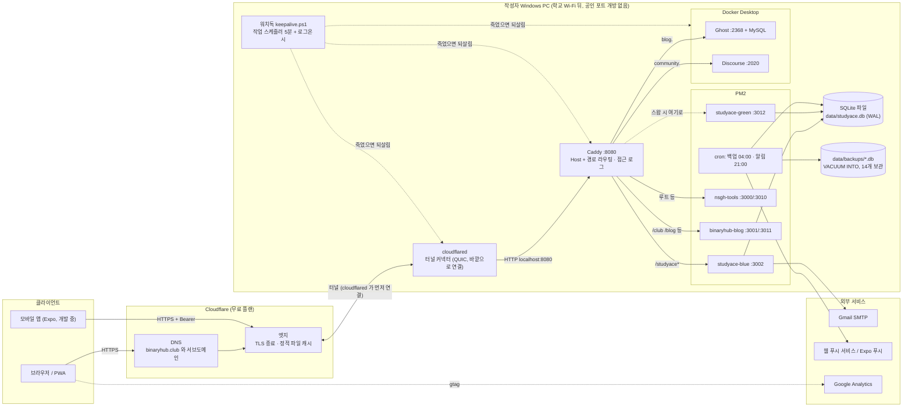

# StudyAce 세미나 맥락 자료

> 작성: 2026-10-13. 「개발 실무 세미나」 발표 자료를 만들 다른 세션에 넘기는 사실 자료다.
>
> **근거:** 레포(`C:\Users\re\studyace`), 리버스 프록시·터널·워치독 설정(`C:\Users\re\bbb\Caddyfile`, `~\.cloudflared\config.yml`, `bbb\scripts\*.ps1`), PM2 설정, 인수인계 문서(`docs/HANDOFF.md`, `docs/TODO.md`), Claude Code 대화 기록(studyace 세션, 인프라를 처음 세운 bbb 세션), 그리고 2026-10-13 에 PM2·Docker·라이브 DB(읽기 전용)를 직접 조회한 결과.
>
> **검증:** 2026-10-13 밤 같은 세션에서 한 번 더 대조했다. 대조한 것은 커밋 수, 라이브 DB 수치, `config.yml`, Caddyfile, `ecosystem.config.js`, `.env` 키 이름, 워치독 로그, PM2 상태, 속도 제한 값이다. 그때 틀린 곳을 고치고 사례 16 을 더했다.
>
> **표기:** 근거 없이 정황으로 판단한 것은 **[추측]** 이라고 적었다. 레포나 기록으로 확인할 수 없는 것은 **확인 필요** 라고 적었다(주로 Cloudflare 대시보드 설정).
>
> **마스킹:** 터널 ID, 계정 태그, zone ID, 이메일 주소, 측정 ID, 광고 게시자 ID, 실제 클라이언트 IP, 비밀번호와 키 값은 `<…>` 로 가렸다. 공개 도메인(`binaryhub.club`)과 `localhost` 포트 번호는 그대로 두었다. 둘 다 구조를 설명하는 데 필요하고 비밀이 아니다.

---

## 0. 한눈에

- **무엇:** 고등학생용 학습 웹앱 **StudyAce**. 주소는 `https://binaryhub.club/studyace`.
- **어디서:** 작성자 개인 **Windows 11 PC 한 대**에서 돈다. 이 PC 는 개발 머신이면서 운영 서버다. 같은 PC 에서 다른 사이트 4개도 함께 돈다.
- **어떻게 노출:** 공인 IP 나 포트포워딩 없이 **Cloudflare Tunnel**(`cloudflared`)을 쓴다. 터널 뒤에서 리버스 프록시 **Caddy** 가 Host 와 경로로 앱을 고른다.
- **백엔드:** Next.js 앱 안의 Route Handlers 와 **SQLite 파일 하나**. 별도 API 서버나 DB 서버는 없다.
- **배포:** CI/CD 없이 **수동 blue/green**. 두 포트에 두 빌드를 띄워 두고 Caddy 가 가리키는 포트 한 줄만 바꾼다. 2026-08-25 부터 10-13 까지 **50번** 스왑했다.
- **세미나에서 쓸 만한 이야기:** 「클라우드(Workers+D1)를 버리고 집 PC 로 왔다」는 결정과 그 대가(가용성, 백업). 앞단이 통째로 죽은 530 장애와 워치독. 「느리다」의 원인이 서버가 아니라 망(Cloudflare 시애틀 경유)이었던 사례.

---

## 1. 서비스 개요

### 무엇을 하는 서비스인가

학교 시험 대비 학습 앱이다. 과목은 한국사 객관식, 영어 단어 암기, 화학(알케인 명명)이다. 핵심 아이디어는 다음과 같다(`docs/HANDOFF.md` §1).

- **문항마다 반응 시간을 재서 복습 간격을 정한다.** 정답이어도 빨리 떠올렸으면 간격이 길고, 오래 걸렸으면 짧다. 실측 예: 정답 5회, 0.7초 → 다음 복습 19.7일, 4.5초 → 1.7일. 이후 사용자 요청으로 간격을 시험 기간에 맞게 좁혔다.
- **게임 요소:**
  - 포인트(원장 방식)
  - 뽑기(가챠)로 얻는 유물 수집
  - 주간 랭킹과 티어
  - 칭호
  - 연속 정답 보너스
- **운영 기능:** 관리자 페이지(승인, 권한, 포인트, 감사 로그, 운영 설정), 공지와 이벤트, 웹 푸시 저녁 알림, 메일 인증과 비밀번호 재설정.
- **공개 영역:** 로그인 없이 보는 랜딩, 단원별 문항 아카이브, 맛보기 3문제. 애드센스와 검색 색인용이다.

### 사용자

- 작성자가 다니는 고등학교 학생들. 관리자와 검수자는 작성자와 교사·동료다.
- 라이브 DB 실측(2026-10-13, 읽기 전용):

  | 항목 | 값 |
  |---|---|
  | 계정 | 86 (관리자 2, 검수자 3, 일반 81) |
  | 최근 7일 안에 학습한 사용자 | 28명 |
  | 누적 학습 기록(`study_events`) | 14,269건 (2026-08-25 ~ 10-13) |
  | DB 크기 | 본 파일 약 8MB + WAL 약 4MB |
  | 마이그레이션 | 32개 |

### 현재 운영 상태

- **라이브 중.** 2026-10-13 기준 blue 슬롯(:3002)이 라이브다. 사실 확인은 `Caddyfile` 에서 한다.
- **개발 기간:**
  - 레포 첫 커밋은 2026-08-24, 커밋 430개다(2026-10-13 밤 기준). 커밋이 있는 날이 35일이다.
  - 2026-08-25 에 자체 백엔드와 자체 호스팅으로 전환했다.
  - 그 뒤 7주 동안 blue/green 스왑을 50번 했다.
- **버전 역사:**
  - **v1:** 정적 SPA(HTML 파일) + Cloudflare Worker + D1(서버리스 SQLite). 다른 개발자가 만든 것을 이어받았다.
  - **v2 (지금):** 2026-08-24 Next.js 로 다시 썼다. 08-25 에 백엔드를 앱 안으로 들이고, 이 PC 로 옮겼다.
    - 옛 사용자 68명을 비밀번호 그대로 이관했다(PBKDF2 파라미터를 맞췄다).
    - 옛 Worker 는 지우지 않고 라우트만 걷었다. 롤백용이다.
- **모바일 앱(React Native/Expo):** 별도 브랜치(`feat/app-shell`)에서 개발 중이고 **아직 출시 전**이다. 앱용 API(`/api/app/v1/*`, Bearer 인증)의 첫 버전은 서버에 배포되어 있다.
- **같은 PC 의 다른 서비스:**
  - `binaryhub.club` 루트: 북곽툴즈(Next)
  - 옛 포털과 부원 블로그(Next)
  - `blog.binaryhub.club`: Ghost
  - `community.binaryhub.club`: Discourse

---

## 2. 시스템 아키텍처

### 전체 구성도



### 컴포넌트 역할과 통신

| 컴포넌트 | 역할 | 통신 |
|---|---|---|
| Cloudflare DNS | 도메인의 네임서버. 등록기관(가비아)에서 네임서버를 Cloudflare 로 바꿨다 | 터널 호스트는 터널을 가리키는 CNAME 이다 (`cloudflared tunnel route dns` 가 만든다) |
| Cloudflare 엣지 | HTTPS 종료, `/_next/static` 같은 정적 파일 캐시 | 클라이언트와 HTTPS. 오리진 쪽은 터널 |
| cloudflared | PC 안의 터널 커넥터. **PC 가 바깥(Cloudflare)으로 연결을 연다.** 그래서 들어오는 포트를 열 필요가 없다 | 로그상 프로토콜 `quic`, 접속 지점은 `icn01`/`icn06`/`icn07`(인천). 받은 요청을 `http://localhost:8080` 으로 넘긴다 |
| Caddy (:8080) | 리버스 프록시. Host 헤더와 경로로 앱을 고른다. http → https 리다이렉트, JSON 접근 로그 | 평문 HTTP, 루프백만. `auto_https off` (TLS 는 Cloudflare 가 한다). 관리 API 는 `localhost:2019` |
| StudyAce blue/green | Next.js 16 `next start`. 화면(서버 컴포넌트)과 API(Route Handlers)를 한 프로세스가 같이 낸다 | Caddy 에서 HTTP. 둘 다 **같은 SQLite 파일**을 연다 |
| SQLite (better-sqlite3) | 유일한 데이터 원본. WAL 모드, `busy_timeout=5000`, 외래키 켬 | 같은 프로세스 안 라이브러리 호출. 네트워크 없음 |
| PM2 | Node 프로세스 관리(재시작, 메모리 1G 넘으면 재시작), cron 작업 | 윈도우 로그온 때 레지스트리 Run 키의 `pm2_resurrect.cmd` 로 되살아난다 |
| Docker Desktop | Ghost(+MySQL), Discourse 컨테이너. StudyAce 와는 무관 | Ghost 는 `127.0.0.1:2368` 만 연다 |
| 워치독 | Caddy·cloudflared·Docker 가 죽었으면 되살린다 | 작업 스케줄러 5분마다 + 로그온 30초 뒤 한 번 |
| Gmail SMTP | 가입 인증, 비밀번호 재설정 메일. Ghost 블로그와 같은 계정을 쓴다 | nodemailer, `.env` 의 SMTP 값 |
| 웹 푸시 / Expo 푸시 | 저녁 알림 | PM2 cron 이 VAPID 키로 보낸다 |
| Google Analytics | 방문 분석(`anonymize_ip`) | 브라우저에서 직접 |

### 요청 하나의 흐름

**예: 로그인한 학생이 문항에 답을 낸다.** 요청은 `POST https://binaryhub.club/studyace/api/study/answer` 이다.

1. **브라우저:** DNS 조회 결과 Cloudflare 엣지 IP 로 간다. TLS 는 엣지에서 끝난다.
2. **Cloudflare 엣지:** 이 호스트가 터널 소속인 것을 보고, PC 의 cloudflared 가 미리 열어 둔 연결로 요청을 보낸다.
   - 이때 `CF-Connecting-IP`(원래 클라이언트 IP)와 `X-Forwarded-Proto` 헤더가 붙는다.
3. **cloudflared:** `config.yml` 의 ingress 규칙이 `binaryhub.club → http://localhost:8080` 이므로 Caddy 로 넘긴다.
4. **Caddy:** 처리 순서는 이렇다.
   1. `X-Forwarded-Proto: http` 이면 https 로 301.
   2. Host 가 `binaryhub.club` 이고 경로가 `/studyace` 또는 `/studyace/*` 이면 `localhost:3002`(지금 라이브 슬롯)로 보낸다.
   3. JSON 접근 로그에 한 줄 남긴다.
5. **Next (`next start`, basePath `/studyace`):** 처리 순서는 이렇다.
   1. `proxy.ts`(미들웨어 자리)가 세션 쿠키가 있는지만 본다.
   2. Route Handler 가 `getSessionUser()` 로 쿠키의 토큰을 SHA-256 해시해 `sessions` 표와 대조한다.
   3. 속도 제한(계정당 1분 90회, 1시간 3000회)을 본다. 기록은 DB 의 `auth_attempts` 에 있다. 처음엔 40회·600회였는데 실제 학생이 막혀서 올렸다(5장 사례 16).
   4. **서버가 채점하고** 포인트 원장과 복습 일정을 쓴다. 한 트랜잭션이고, 지급 상한은 DB 의 부분 유니크 인덱스가 막는다.
6. **응답:** 같은 길을 거꾸로 돌아간다.

화면 요청(`GET /studyace`)도 같은 경로다. 서버 컴포넌트가 DB 를 직접 읽어 HTML 을 만든다. `/_next/static/<BUILD_ID>/…` 같은 정적 파일은 Cloudflare 엣지가 캐시해서 두 번째부터는 PC 까지 오지 않는다(`cf-cache-status: HIT`).

---

## 3. 기술 스택과 선택 이유

| 레이어 | 쓰는 것 | 왜 / 대안 / 트레이드오프 |
|---|---|---|
| 프론트 | Next.js 16 App Router, React 19, TypeScript, Tailwind v4, shadcn/ui(Base UI), lucide, react-hook-form + zod, vaul. 연출에 GSAP, PixiJS | 디자인 시안(Figma)을 그대로 옮기려고 골랐다. 이유를 따로 논의한 기록은 없다 → **확인 필요**. basePath `/studyace` 는 **애드센스 심사에서 루트 도메인 신호를 모으려고** 서브도메인 대신 경로를 쓴 것이다(`next.config.ts` 주석) |
| 백엔드 | **같은 Next 앱의 Route Handlers + 서버 컴포넌트.** 별도 API 서버 없음 | 아래 「결정 1」 |
| DB | **SQLite**(better-sqlite3) + Drizzle ORM, WAL 모드 | 아래 「결정 1」. 마이그레이션은 drizzle 스냅샷이 실제 스키마를 못 따라가서 **SQL 을 손으로 쓴다**(`AGENTS.md`) |
| 인증 | **httpOnly 쿠키 세션**(DB 에 토큰 해시 저장, 30일). 앱은 같은 `sessions` 표를 Bearer 토큰으로 쓴다(90일) | 아래 「결정 2」 |
| 비밀번호 | PBKDF2 10만 회 / 16바이트 솔트 | 옛 사용자를 재설정 없이 이관하려고 v1 과 같은 파라미터를 유지했다. `scripts/verify-password-compat.mjs` 가 테스트로 고정한다 |
| 캐시 | **캐시 서버(Redis 등) 없음.** Cloudflare 엣지가 정적 파일을 캐시하고, 서비스 워커(`public/sw.js`)가 정적 자산을 캐시한다 | 사용자 수가 적어 SQLite 직접 조회로 충분하다는 판단으로 보인다 → **[추측]**, 명시적 논의 기록 없음 |
| 속도 제한 | **DB 에 기록**(`auth_attempts` 표를 키 접두사로 나눠 씀) | **메모리에 두지 않은 이유:** blue/green 스왑이나 PM2 재시작마다 카운터가 0 이 된다. 「재시작을 유도할 수 있으면 제한이 없는 것과 같다」(대화 기록 2026-08-26) |
| 파일 저장 | 로컬 디스크(`content/`). 교과서 그림은 로그인 뒤 라우트로만 낸다 | 저작권 자료라서 `public/` 에 두지 않았다. 객체 스토리지는 안 쓴다 |
| 메일 | nodemailer + Gmail SMTP(Ghost 블로그와 공유) | 비용 0. **하루 약 500통 한도를 블로그와 나눠 쓴다.** 그래서 요청에 속도 제한을 걸었다. 학교 메일(`goedu.kr` 등)이 Gmail 발신을 막는 경우가 있어 관리자가 직접 임시 비밀번호를 주는 대체 경로를 뒀다 |
| 푸시 | web-push(VAPID) + Expo 푸시 | 발송은 **앱 프로세스가 아니라 PM2 cron 하나**가 한다. 아래 5장 사례 |
| 로깅/모니터링 | Caddy JSON 접근 로그(20MiB × 10개 회전), PM2 로그, 워치독 로그, DB 의 `audit_log`(관리자 행동, 거절된 시도), GA | **외부 모니터링이나 알림(업타임 체크, APM)은 찾지 못했다** → **확인 필요**. 장애는 지금까지 사람이 먼저 알아챘다(5장) |
| 테스트 | `node --test`(순수 모듈) + Vitest(jsdom, 화면) | CI 는 없다. 배포 전에 손으로 돌린다 |
| 모바일 | Expo SDK 57, React Native 0.86, Expo Router, TanStack Query | 개발 중. 앱 디자인은 웹을 따른다 |
| 개발 방식 | 대부분 **Claude Code**(AI 코딩 에이전트) 세션으로 개발했다. 세션 사이 인수인계는 `docs/HANDOFF.md`(약 2,000줄)와 메모리 파일로 한다 | 세미나에서 「AI 와 같이 운영할 때 무엇을 문서로 남기나」의 사례로 쓸 수 있다 |

### 결정 1 — 클라우드(Workers + D1)를 버리고 집 PC 의 SQLite 로 (2026-08-25)

대화 기록에 실제 고민이 남아 있다. 세미나의 중심 이야기로 쓸 만하다.

- **원래 구조(v1):**
  - Cloudflare Worker + D1 이었다. PC 와 무관하게 항상 떠 있고, D1 Time Travel 로 30일 백업이 된다.
  - 다만 **클라이언트가 점수 카운터 뭉치를 소유하고 통째로 덮어쓰는** 구조였다. 그래서 다음 부채가 생겼다:
    - 409 충돌 처리
    - 어뷰징 막기 휴리스틱
    - 점수식이 클라이언트와 서버에 이중으로 있음
- **사용자 요청:** 「구버전 백엔드를 굳이 활용할 필요는 없고, 뭐가 안 맞는다면 아예 새로 만드는 게 나을 수도」.
- **AI 의 첫 판단(정정 전):**
  - 「이 PC 로 옮기면 PC 가 꺼질 때 서비스도 죽고 백업은 수동이 된다. 가용성 후퇴다.」
  - 그래서 **Workers + D1 에 두고 내부만 새로 쓰자**고 권했다.
- **사용자 반박:** 「클라우드는 cpu 같은 거 제한이 있을걸」. Workers 무료 플랜은 요청당 CPU 10ms 이고, 통계 집계나 배치 재계산을 붙이면 바로 닿는 천장이다.
- **결론:** 이 PC 로 간다. 대신 **자동 백업을 의무로** 넣는다.
- **함께 얻은 것:**
  - 옛 Worker 라우트가 `/studyace/*` 전체를 잡고 있어 새 앱을 올릴 자리가 없던 문제가 사라졌다.
  - API 가 같은 출처라 CORS 가 없다.
  - 무료 플랜 하루 요청 한도에서 벗어났다. 대화에 「이미 한 번 터진 적 있음」이라는 언급이 있으나 세부 기록은 **확인 필요**.
  - 관리자 페이지를 같은 앱의 서버 컴포넌트로 만들 수 있다.
- **치른 대가(지금도 유효):**
  - PC 와 집·학교 망이 단일 장애점이다(5장의 530 장애들).
  - DB 백업을 직접 책임진다. `VACUUM INTO`, 매일 04:00, 14개 보관.
  - **백업이 같은 디스크에 있다.** 다른 장소에 복사하는 장치는 찾지 못했다 → **확인 필요**.
- **구조 변화:** 「서버가 단독 소유」로 바뀌었다.
  - 클라이언트는 「이 문항을 이만큼 걸려 이렇게 풀었다」는 사실만 보낸다. 판정, 포인트, 복습일은 서버가 정한다.
  - 학습 기록은 추가만 하는 로그(`study_events`)이고, 포인트는 원장(잔액 = 합계)이다.

### 결정 2 — JWT 대신 DB 세션 쿠키

`src/server/auth/session.ts` 주석에 나온 이유는 두 가지다.

1. **취소 가능:** JWT 는 만료 전까지 못 막는다. 관리자가 정지해도 토큰이 살아 있었다. DB 행을 지우면 즉시 끊긴다(실측 확인).
2. **XSS 로 못 훔침:** localStorage 와 달리 httpOnly 쿠키는 스크립트가 못 읽는다.

이 선택이 가능했던 것은 API 가 같은 출처로 들어왔기 때문이다. 크로스 오리진이었다면 SameSite 제약 때문에 이 선택지가 없었다. 쿠키 설정은 `httpOnly`, `sameSite: lax`, 운영에서는 `secure` 이다.

### 결정 3 — 공인 IP 노출 대신 Cloudflare Tunnel

4장에 정리했다. 「왜 터널인가」를 명시적으로 따진 대화는 찾지 못했다. 정황은 4장에 적었다.

---

## 4. 배포와 인프라

### 4.1 서버가 어디서 도나

- 작성자의 **Windows 11 Pro 데스크톱 한 대.** 클라우드 VM 이나 PaaS 가 아니다.
- **개발 머신 겸 운영 서버**다. 같은 PC 에서 개발 서버, 시험 서버(:3099), 이미지 생성 학습(GPU)도 돈다. 그래서 「운영 프로세스를 실수로 죽이는」 사고가 실제로 났다(5장).
- 네트워크는 **학교 Wi-Fi(KT 회선)** 다(2026-10-12 조사).
- **원격 데스크톱으로 관리한다.** 2026-10-13 조회에서 `caddy.exe`, `cloudflared.exe` 가 세션 `RDP-Tcp#2` 안에서 돌고 있었다. 앞단 프로세스가 Windows 서비스가 아니라 **사용자 로그온 세션**에 붙어 있다는 뜻이다(4.7, 사례 5).
- UPS·전원·하드웨어 사양은 **확인 필요**.

### 4.2 Cloudflare Tunnel

**왜 썼나:**

- 대화 기록에 명시적인 비교 논의는 없다 → **확인 필요**.
- 정황상 이유 **[추측]:**
  - 서버가 학교 Wi-Fi 뒤에 있다. 학생들이 같은 공인 IP 를 NAT 로 나눠 쓴다는 기록이 있다(속도 제한을 IP 기준으로 못 조인 이유).
  - 따라서 공인 IP 할당이나 공유기 포트포워딩을 할 수 없는 환경이다.
  - 터널은 PC 가 **바깥으로** 연결을 열기 때문에 들어오는 포트가 필요 없고, 인증서도 Cloudflare 가 관리한다.
- 코드 주석(`src/server/auth/rate-limit.ts`): 「이 앱의 포트는 터널 밖으로 열려 있지 않아 프록시를 거치지 않고는 닿을 수 없다」.

**설치와 설정 과정** (2026-05-29, 인프라를 처음 세운 bbb 세션 기록):

1. `winget` 으로 cloudflared 와 PM2 설치.
2. **(사람이 할 일)** Cloudflare 대시보드에 `binaryhub.club` 추가, Free 플랜. 등록기관(가비아)에서 네임서버를 Cloudflare 가 준 2개로 바꾸고 Active 가 될 때까지 기다림.
3. `cloudflared tunnel login`: 브라우저에서 도메인을 고르고 Authorize 하면 인증서 파일(`cert.pem`)이 `~/.cloudflared/` 에 저장된다.
4. `cloudflared tunnel create <이름>`: 터널 ID 와 자격 증명 JSON(`<TUNNEL-ID>.json`)이 생긴다.
5. `cloudflared tunnel route dns <터널> <호스트명>`: 호스트명마다 CNAME 이 생긴다.
6. `config.yml` 작성 후 실행.
   - 처음에는 PM2 로 cloudflared 를 띄웠다.
   - 2026-09 기록에서는 「winget 바이너리를 수동 실행」하는 구조였고, 지금은 워치독이 띄운다(4.7).
7. 나중에 호스트(blog., community.)를 추가할 때도 `tunnel route dns` 를 한 번 더 하고 `config.yml` 에 줄을 더했다.

**`config.yml` 구조** (`C:\Users\re\.cloudflared\config.yml`, 마스킹):

```yaml
tunnel: <TUNNEL-ID>
credentials-file: 'C:\Users\re\.cloudflared\<TUNNEL-ID>.json'

ingress:
  - hostname: tools.binaryhub.club
    service: http://localhost:8080
  - hostname: binaryhub.club
    service: http://localhost:8080
  - hostname: community.binaryhub.club
    service: http://localhost:8080
  - hostname: blog.binaryhub.club
    service: http://localhost:8080
  - service: http_status:404      # 위에 없는 호스트는 404 (마지막 규칙은 필수)
```

- **설계 포인트:** 터널은 호스트 4개를 **전부 Caddy 한 곳(:8080)** 으로 보낸다. 앱별 분기는 Caddy 가 맡는다. 터널 설정은 거의 안 바뀌고, 배포 때 바뀌는 것은 Caddyfile 뿐이다.
- 자격 증명 JSON 에는 `AccountTag`, `TunnelSecret`, `TunnelID`, `Endpoint` 가 들어 있다. **비밀**이다. 값은 열어 보지 않았다.
- 같은 PC 에 다른 프로젝트용 터널 설정이 3개 더 있다(`sada-*.yml`, `tetris.yml`, 도메인 생략). 하나는 `path: /ws` 로 웹소켓 경로만 다른 포트로 보낸다. **터널 하나에 여러 서비스, 경로별 분기**의 예로 쓸 수 있다.

**Cloudflare Access 같은 보안 설정:**

- `config.yml` 에는 Access 관련 설정이 없다. 대시보드의 Access 정책 여부는 **확인 필요**.
- 관리자 페이지(`/admin`)는 앱 자체 로그인과 역할(`admin`)로 막는다.
- 그 밖에 Cloudflare 기본 보호가 짧은 간격의 인증 POST 반복을 멈춘 적이 있다(2026-08-26 기록). 어떤 기능(봇 보호, WAF 등)이었는지는 **확인 필요**.

### 4.3 도메인과 HTTPS

- **도메인:** `binaryhub.club`. 등록기관은 가비아, DNS 는 Cloudflare(Free 플랜).
- **TLS 종료 위치:** Cloudflare 엣지. 엣지와 PC 사이는 터널(cloudflared 와 Cloudflare 사이 암호화 연결)이다. **PC 안(cloudflared → Caddy → Next)은 평문 HTTP 루프백**이다.
  - Caddy 는 `auto_https off` 라서 인증서를 직접 받지 않는다.
- **http → https:** Caddy 가 `X-Forwarded-Proto: http` 를 보고 301 로 보낸다. 이유는 5장 사례 9.
  - 대시보드의 「Always Use HTTPS」를 켜면 엣지에서 먼저 끊어 준다는 메모가 Caddyfile 에 있다. 실제로 켜져 있는지는 **확인 필요**.
- Cloudflare SSL/TLS 암호화 모드(Flexible/Full 등)는 **확인 필요**. 터널을 쓰면 오리진 인증서가 필요 없어 이 설정의 의미가 작아진다 → **[추측]**.
- 쿠키는 운영에서 `secure`. 클라이언트 IP 는 `CF-Connecting-IP` → `X-Forwarded-For` 순으로 읽는다.

### 4.4 컨테이너화

- **StudyAce 는 컨테이너를 안 쓴다.** Windows 에서 Node 로 `next start` 를 직접 돌리고 PM2 가 관리한다. Dockerfile 이나 compose 파일이 레포에 없다.
- Docker 를 쓰는 것은 같은 PC 의 **Ghost 블로그**(`bbb/ghost/docker-compose.yml`)와 **Discourse 커뮤니티**다.
  - Ghost compose 구성:
    - `ghost:5-alpine` + `mysql:8`
    - `restart: unless-stopped`
    - Ghost 포트는 `127.0.0.1:2368` 에만 열어 Caddy 만 닿게 했다
    - MySQL 은 healthcheck 가 통과해야 Ghost 가 뜬다(`depends_on: condition: service_healthy`)
    - 데이터는 로컬 폴더 볼륨
  - Docker 는 Docker Desktop(GUI 앱)이라 사용자 로그온이 필요하다. 워치독도 이 때문에 사용자 권한으로 돈다.
- StudyAce 를 컨테이너로 안 한 이유를 논의한 기록은 없다 → **확인 필요**.
- 관련 메모(`next.config.ts`): `output: "standalone"` 을 쓰면 빌드 추적이 교과서 원본 PDF 와 운영 DB 까지 산출물에 복사한다. 그래서 추적 대상에서 `content/` 와 `data/` 를 뺐다. 컨테이너 이미지로 갈 때 「저작권 자료와 DB 가 이미지에 들어가는」 함정의 실례다.

### 4.5 배포 방식 — 수동 blue/green

- **CI/CD 없음.** `.github/` 가 없다. 배포는 사람(또는 AI 세션)이 명령을 순서대로 친다.
- 같은 PC 의 블로그와 툴즈는 `bbb/scripts/deploy.ps1 -App blog|tools` 가 자동화돼 있다(빌드, 대기 슬롯 재시작, 헬스체크, Caddy 스왑, 검증 실패 시 Caddyfile 롤백, 옛 슬롯 정지). StudyAce 는 아래 이유로 문서 절차를 손으로 따른다.
  - 마이그레이션 시점을 사람이 정해야 한다.
  - 미완성 작업을 빌드에서 빼야 할 때가 있다(5장 사례 13).
  - 옛 슬롯을 끄지 않고 롤백용으로 켜 둔다. `deploy.ps1` 은 마지막 단계에서 옛 슬롯을 끈다.
- ⚠️ **문서가 현실과 어긋난 예:** Caddyfile 의 StudyAce 주석에는 「scripts/deploy.ps1 이 대신 한다」고 적혀 있다. 하지만 `deploy.ps1` 의 앱 목록에는 blog 와 tools 만 있다(2026-10-13 확인). 같은 Caddyfile 에는 「2026-09-17 에 주석이 뒤처져 거짓이 됐다(주석은 green, 포트는 3002)」는 경고도 있다. 손 배포에서는 「주석과 문서도 배포 대상」이라는 교훈의 실례다.

**StudyAce 배포 순서** (`docs/HANDOFF.md` §5 「blue/green 스왑」):

```powershell
# 1. DB 백업 — 마이그레이션이 있든 없든 먼저
npm run db:backup
# 2. 대기 슬롯에 새 빌드 (라이브가 blue 면 대기는 green)
$env:NEXT_DIST_DIR=".next-<대기>"; npx next build
# 3. 마이그레이션은 스왑 «직전»에 — 먼저 돌리면 옛 빌드가 새 스키마 위에서 도는 시간이 생긴다
npm run db:migrate
# 4. 대기 슬롯 재시작 후, Caddy 를 넘기기 전에 직접 찔러 본다
npx pm2 restart studyace-<대기>
curl http://127.0.0.1:<대기포트>/studyace/login
# 5. Caddyfile 의 reverse_proxy 포트 한 줄을 바꾸고 무중단 reload
caddy reload --config C:/Users/re/bbb/Caddyfile --address localhost:2019
# 6. 공개 URL 에서 BUILD_ID 로 확인 → pm2 save → 문서·Caddyfile 주석 갱신
npx pm2 save
```

- **「새 빌드가 실제로 도는가」 확인법:** App Router 페이지 HTML 에는 BUILD_ID 가 안 박힌다. 대신 빌드 ID 가 경로에 들어간 정적 파일을 찔러 200/404 를 본다.
  ```bash
  curl -s -o /dev/null -w "%{http_code}" https://binaryhub.club/studyace/_next/static/<새 BUILD_ID>/_buildManifest.js   # 200 이어야
  ```
- **두 슬롯이 같은 DB 를 연다.**
  - WAL 모드와 `busy_timeout` 덕에 잠깐 동시에 떠 있어도 안전하다.
  - 롤백용으로 옛 슬롯을 켜 둔다(실측: 2026-10-13 두 슬롯 모두 online).
- **롤백:**
  - Caddyfile 포트를 되돌리고 `caddy reload` 하면 끝이다(초 단위).
  - 배포마다 직전 Caddyfile 을 `Caddyfile.bak-<작업이름>-<날짜>` 로 남긴다. 2026-10-13 기준 `bbb/` 에 34개, 더 오래된 것은 `bbb/caddy-history/` 에 35개가 있다. Caddyfile 은 git 으로 관리하지 않는다 → 파일 복사본이 버전 관리 노릇을 한다.
  - **마이그레이션은 안 돌아온다.** 스키마를 되돌리려면 1번 백업에서 복구한다.
  - 옛 빌드가 새 데이터를 잘못 다룰 수 있으면 데이터도 같이 손본다. 예: 어려움 모드 배포 때 「롤백하면 어려움 문항을 archived 로 바꿀 것」을 미리 적어 뒀다.
- **배포 기록:** 스왑마다 `docs/HANDOFF.md` 에 라이브 슬롯, BUILD_ID, 마이그레이션 번호, 롤백 대상, 직전 백업 파일 경로를 적는다. Caddyfile 주석에도 같은 내용을 적는다.

### 4.6 환경변수와 시크릿

- **`.env`(레포 루트, `.gitignore` 의 `.env*` 로 제외).** 키 이름만 적는다:
  - `VAPID_PUBLIC_KEY`, `VAPID_PRIVATE_KEY`, `VAPID_SUBJECT`: 웹 푸시
  - `GA_MEASUREMENT_ID`
  - `SMTP_HOST`, `SMTP_PORT`, `SMTP_USER`, `SMTP_PASS`, `MAIL_FROM`
- **비밀이 아닌 실행 설정은 `ecosystem.config.js`(커밋됨)에 둔다:** `NODE_ENV`, `NEXT_DIST_DIR`(슬롯별 빌드 폴더), `STUDYACE_DB_PATH`.
  - DB 경로는 **절대경로로 못박았다.** PM2 가 어디서 띄우느냐에 따라 blue 와 green 이 다른 DB 파일을 볼 수 있어서다.
- `next start` 는 `.env` 를 스스로 읽는다. **cron 스크립트는 안 읽어서** `node --env-file=.env` 를 명시한다.
  - 키가 없으면 스크립트가 죽어 PM2 에 실패로 남는다. 「조용히 0통 보내고 성공」하지 않게 했다.
- **런타임에 바꾸는 값은 DB 에 둔다:** 포인트 지급액, 큰 공지 켜고 끄기 등은 관리자 화면(`/admin/settings`, `app_settings` 표)에서 고친다. 재배포가 필요 없다.
- **시크릿 백업은 수동이다.**
  - `.env` 를 잃으면 VAPID 키가 바뀌어 **모든 푸시 구독이 무효**가 된다.
  - DB 백업에는 구독 행만 있고 키는 없다. 서버를 옮길 때 `.env` 를 따로 챙겨야 한다(HANDOFF 경고).
  - 블로그 백업 스크립트에도 「시크릿은 별도 안전 보관 필요」라고 적혀 있다.
  - 비밀 관리 도구(Vault, Doppler 등)는 안 쓴다.
- 앱에서 쓰는 DB 경로 같은 환경변수는 **Windows 형식으로 줘야 한다.** 5장 사례 14.

### 4.7 프로세스 관리

| 대상 | 방식 | 부팅·크래시 때 |
|---|---|---|
| Next 앱 6개(StudyAce, 툴즈, 포털 × blue/green) | PM2. `autorestart`, `max_memory_restart: 1G` | 로그온 때 레지스트리 Run 키의 `pm2_resurrect.cmd` 가 `pm2 save` 해 둔 목록을 되살린다 |
| 백업, 저녁 알림 | PM2 `cron_restart`(`0 4 * * *`, `0 21 * * *`), `autorestart: false` | 위와 같다 |
| Caddy, cloudflared | **서비스로 등록돼 있지 않다**(`sc query` 결과 없음). winget 바이너리를 숨김 창으로 실행 | **워치독**(`bbb/scripts/keepalive.ps1`)이 되살린다 |
| Ghost, MySQL, Discourse | Docker `restart: unless-stopped` | Docker Desktop 은 레지스트리 Run 키로 자동 시작하고, 워치독도 확인한다 |

워치독의 동작:

- Caddy 는 `:8080` 이 LISTEN 중인지로 판단한다. 프로세스가 있어도 포트가 안 열려 있으면 죽은 것으로 본다.
- Caddy 를 재시작하기 전에 `caddy validate` 를 먼저 돌린다. 설정이 깨졌으면 시작해도 또 죽으므로 손대지 않고 「사람이 봐야 함」이라고 기록한다.
- cloudflared 는 프로세스 유무로 판단한다.
- Docker 는 `docker ps` 성공 여부로 판단한다.
- 아무 일도 안 했으면 로그를 남기지 않는다.

워치독의 등록(`install-keepalive.ps1`):

- 작업 스케줄러 `schtasks /SC MINUTE /MO 5` 로 5분마다 돈다.
- 시작프로그램 폴더 바로가기로 로그온 30초 뒤 한 번 더 돈다.
- 이렇게 만든 이유는 5장 사례 5, 6.

---

## 5. 운영하면서 겪은 문제와 해결

날짜는 대화 기록과 문서 기준이다. 세미나에 쓰기 좋은 순서로 골랐다.

### 사례 1. 개발 서버를 끄려다 운영 사이트를 내림 (2026-08-25)
- **증상:** StudyAce 배포 작업 중 `binaryhub.club` 과 `tools.binaryhub.club` 이 502.
- **원인:** 개발 서버를 정리하려고 `taskkill //IM node.exe //F` 를 썼다. 운영 사이트도 같은 PC 의 Node 프로세스라 함께 죽었다.
- **해결:** PM2 로 재기동. 이참에 수동 실행이던 툴즈와 블로그도 PM2 아래로 넣고 `pm2 save`. 앞으로는 포트로 PID 를 찾아 그것만 끈다(`netstat -ano | grep :<포트>` → `taskkill //PID`).
- **교훈:** 개발 머신 = 운영 서버이면 「내 프로세스만」이라는 가정이 성립하지 않는다. 종료는 이름이 아니라 **포트/PID 로 특정**한다.

### 사례 2. 경로 매처 한 글자 차이로 404 (2026-08-25, 전환 당일)
- **증상:** `binaryhub.club/studyace` 가 블로그의 404 로 갔다.
- **원인:** Caddy 매처 `/studyace/*` 는 슬래시 없는 `/studyace` 를 못 잡는다. 앱이 `/studyace/` → `/studyace` 로 308 하므로 그 요청이 기본 `handle` 로 새어 블로그 앱(:3001)으로 갔다.
- **해결:** `@studyace path /studyace /studyace/*`.
- **교훈:** 옛 Worker 라우트를 걷기 **전에** Host 헤더를 위조해 프록시를 먼저 검증했다. 그래서 라이브가 안 깨졌다.
  ```bash
  curl -sL -H "Host: binaryhub.club" http://localhost:8080/studyace
  ```
  DNS 를 바꾸지 않고 프록시 라우팅만 시험하는 방법이다.

### 사례 3. blue 와 green 이 같은 폴더를 쓰고 있었다 (2026-08-25)
- **증상:** blue/green 이 서로의 빌드를 덮어쓸 수 있는 상태.
- **원인:** 다른 앱들은 `NEXT_DIST_DIR` 환경변수로 빌드 폴더를 갈랐다. 하지만 **Next 16 은 그 변수를 더는 읽지 않는다.**
- **해결:** `next.config.ts` 에서 `distDir: process.env.NEXT_DIST_DIR || ".next"` 로 직접 받는다.
- **교훈:** 프레임워크 메이저 업그레이드는 배포 스크립트의 전제를 조용히 깬다.

### 사례 4. 재부팅 뒤 사이트 전부 다운 (2026-09-08)
- **증상:** 모든 사이트 접속 불가.
- **원인:** 재부팅 뒤 PM2 와 Docker 는 자동 시작했다. 그러나 **Caddy 와 cloudflared 는 서비스나 스케줄러 등록이 하나도 없어** 안 올라왔다.
- **해결:** 수동 기동. 터널은 커넥션 4개 등록(icn01/icn06).
- **교훈:** 「앱이 살아 있다」와 「사이트가 산다」는 다르다. 앞단(프록시, 터널)도 자동 시작 대상이다.

### 사례 5. 가동 중 앞단 셋이 동시에 사라짐 — 530 (2026-09-17)
- **증상:** 네 사이트 모두 Cloudflare `530`(오류 1033: 터널이 오리진에 못 닿음). 사용자가 Search Console 질문을 하다가 우연히 발견했다.
- **원인:** Caddy, cloudflared, Docker Desktop 이 동시에 죽어 있었다. PM2 앱은 멀쩡했다. **재부팅이 아니었다**(가동 219시간째). 셋 다 수동으로 띄운 것이라 부모(터미널 창 등)가 사라지면 같이 죽는다 → **[추측]**, 원인은 특정 못 함. 이벤트 로그에도 없었다.
- **해결:**
  - 수동 복구.
  - **워치독 `keepalive.ps1`**(5분마다 확인하고 되살림)을 작업 스케줄러에 등록.
  - **Caddy 접근 로그 상설화.** 그때 「Googlebot 이 530 을 받았나」를 볼 방법이 없었다.
- **그 뒤 워치독 로그(`bbb/logs/keepalive.log`, 손 쓴 때만 기록):**

  | 시각 | 한 일 |
  |---|---|
  | 09-17 19:51, 19:54 | 설치 직후 cloudflared 를 두 번 되살림 |
  | 09-20 15:39, 09-22 13:49 | Docker Desktop 시작 |
  | **10-06 14:59** | **Caddy, cloudflared, Docker 셋 다 되살림** — 09-17 과 같은 모양. 사람이 알아채기 전에 복구됐다. 원인은 **확인 필요** |
  | 10-13 12:27, 12:29 | 사례 6 |
- **교훈:** 부팅 시 시작만으로는 「돌던 것이 죽는」 경우를 못 막는다. 주기적으로 확인해야 한다. 로그는 장애가 나기 전에 켜 둬야 쓸모가 있다. 10-06 처럼 **아무도 몰랐던 장애**는 워치독 로그에만 남는다.

### 사례 6. 강제 종료 후 5분 공백 (2026-10-13)
- **증상:** PC 가 강제 종료 끝에 12:24:13 에 다시 켜졌다(부팅 시각은 조사 당시 명령 출력). 앞단 셋(Caddy, cloudflared, Docker)이 꺼진 채였고 **사람이 먼저 알아챘다.**
- **원인:** 워치독은 5분 주기 하나뿐이었다. `install-keepalive.ps1` 주석에 따르면 직전 실행이 11:59 라 다음 정기 실행은 12:29 였다.
- **로그에 남은 것:**
  - `12:27:44` 셋 다 재시작. 정기 실행 시각이 아니므로 사람이 워치독을 손으로 돌린 것으로 보인다 → **[추측]**.
  - `12:29:27` 정기 실행에서 cloudflared 가 **다시** 죽어 있어 또 재시작. 2분 사이에 왜 다시 죽었는지는 **확인 필요**.
- **해결:** 로그온 30초 뒤에도 한 번 돌도록 시작프로그램 바로가기를 추가했다.
  - `schtasks /SC ONLOGON` 은 관리자 권한이 필요해 「액세스 거부」로 등록되지 않았다. 시작프로그램 폴더는 권한 없이 된다.
- **교훈:** 주기 확인은 「부팅 직후」라는 확실한 빈틈을 남긴다. 트리거는 두 종류(주기 + 이벤트)가 필요하다.

### 사례 7. 코드는 갔는데 마이그레이션이 안 갔다 (2026-09-11)
- **증상:** 연속 정답 보너스의 지급 상한이 없어졌다. 한 번 답할 때마다 단계 보너스가 통째로 다시 나갈 수 있었다(11연속 한 문항에 275P). 실지급은 0건이었다(운).
- **원인:** 상한을 **DB 의 부분 유니크 인덱스**로 구현했는데, 마이그레이션 없이 코드만 배포됐다. 문서에는 「인덱스 5개 적용 완료」라고 적혀 있었지만 실제 DB 에는 4개였다.
- **해결:** 마이그레이션 적용. 배포 절차에 「`__drizzle_migrations` 행 수 = `drizzle/*.sql` 파일 수」와 인덱스 개수를 **DB 에 직접 묻는** 확인을 넣었다.
- **교훈:** 「돌렸다」가 아니라 「들어갔다」를 확인한다. 안전장치가 DB 제약이면, DB 에 없을 때 코드가 옳아도 소용없다.

### 사례 8. 배포 확인이 CDN 캐시에 속음 (2026-09-12)
- **증상:** 스왑 뒤에도 공개 URL 에서 **옛** 빌드의 manifest 가 200 이었다.
- **원인:** `/_next/static/` 을 Cloudflare 가 캐시한다(`cf-cache-status: HIT`). 옛 빌드가 라이브이던 동안 한 번이라도 불린 URL 은 엣지에 남는다.
- **해결:** 새 빌드의 200 은 공개 URL 로 본다(스왑 전에 존재한 적 없는 경로라 캐시될 수 없다). 옛 빌드의 404 는 **CDN 을 건너뛰고 오리진에** 묻는다.
  ```bash
  curl -s -o /dev/null -w "%{http_code}" -H "Host: binaryhub.club" http://localhost:8080/studyace/_next/static/<옛 ID>/_buildManifest.js
  ```
- **교훈:** CDN 뒤에서는 「무엇이 응답했는가」를 구분해야 한다.
  - v1 시절 메모: Cloudflare 가 query string 을 무시하고 캐시해서 `?v=2` 캐시 버스팅이 안 먹었다.

### 사례 9. 같은 사이트가 http 와 https 두 벌로 색인됨 (2026-09-18)
- **증상:** Search Console 에 `http://binaryhub.club/` 이 「참조 페이지」로 잡혔다. 크롤 예산의 절반이 중복에 쓰였다.
- **원인:** Cloudflare 는 http 로 들어온 요청도 터널 너머 오리진까지 그대로 보낸다. 오리진(Caddy)은 TLS 를 모르니 둘 다 200 이었다.
- **해결:** Caddy 에서 `X-Forwarded-Proto: http` 이면 https 로 301. 헤더가 없는 로컬 상태 확인 요청은 그대로 통과한다.
- **교훈:** TLS 를 앞단(CDN)에 맡기면, 원래 스킴을 오리진은 헤더로만 안다.

### 사례 10. 「렉이 심하다」 — 서버가 아니라 망이었다 (2026-10-12)
- **증상:** 학생들이 「칭호 화면 렉이 개심함」을 신고했다.
- **조사:**
  - Caddy 접근 로그의 서버 처리 시간 중간값은 `/titles` 12ms, 답 제출 16ms 로 정상이었다.
  - 공개 주소로 재 보니 TCP 연결은 12ms 인데 **TLS 단계에서 1~4초**, 캐시 HIT 요청 하나도 1~9초가 걸렸다.
  - `https://binaryhub.club/cdn-cgi/trace` 의 **`colo=SEA`(시애틀)**. 학교망(KT)에서 이 도메인의 Cloudflare 접속 지점이 시애틀로 잡혔다. 반면 터널은 인천(ICN)에 붙어 있다.
  - 그래서 경로가 학생 → 시애틀 → 인천 → PC 로 왕복한다.
  - 다른 Cloudflare 무료 고객 사이트도 같은 증상이었다. 학교 방화벽의 SNI 차단은 아니었다.
- **해결:**
  - 앱 쪽 완화: 로딩 골격, 대기 표시, 요청 수 줄이기(커밋 `7aa98fd`).
  - 근본 해결은 **결정 대기**(`docs/TODO.md`). 유력한 안은 「서울 리전에 작은 클라우드 서버를 두고 이 PC 와 사설망으로 잇기」다. Cloudflare 유료 플랜은 한국 통신사가 인천으로 보내 준다는 보장이 없어 권하지 않았다.
- **교훈:** 느리다는 신고가 오면 코드보다 먼저 세 가지를 본다. ① 서버 처리 시간(프록시 로그) ② 공개 주소의 TLS/TTFB(`curl -w`) ③ CDN 접속 지점(`/cdn-cgi/trace` 의 `colo`).
  - 무료 CDN 이 「가까운 곳」으로 보내 준다는 보장은 없다.

### 사례 11. 포인트 파밍과 쓰기 증폭 DoS (2026-09-02)
- **증상:** 학생들이 익스플로잇을 공언했다. 감사해 보니 가짜 문항 30개로 310P 를 101ms 만에 벌 수 있었다(랭킹 조작).
- **원인:** 정답 여부(`correct`)를 클라이언트에서 받고 문항 ID 를 검증하지 않았다.
- **해결 1(파밍):** 서버 채점만 원장에 기입, 문항 실재와 상태 검증, 자기 신고 통로의 범위 제한 — 서로 독립인 4개 층.
- **2차 구멍:** 막으며 넣은 방어가 새 구멍을 냈다. 거절된 요청이 매번 감사 로그를 썼고, 속도 제한은 「성공」만 셌다. 스크립트로 두드리면 **SQLite 쓰기 잠금으로 다른 학생 화면이 멈출** 수 있었다.
- **해결 2:**
  - 속도 게이트가 「시도」를 센다.
  - **막을 때는 아무것도 안 쓴다.**
  - 푸시 구독은 계정당 20개로 제한한다.
- **교훈:**
  - 클라이언트가 보낸 「결과」를 믿지 않는다.
  - SQLite 는 쓰기가 하나씩이라 **쓰기 횟수 자체가 공격면**이다.
  - 학생 다수가 같은 학교 NAT 뒤라 IP 한도를 조이면 전교생이 막힌다. 그래서 IP 한도는 이메일 한도보다 훨씬 넉넉하게 잡았다. 같은 PC 의 Ghost 도 같은 이유로 로그인 제한을 풀었다.

### 사례 12. 알림이 두 번 갈 뻔함 — 발송자는 하나여야 한다 (설계 단계, 2026-09-02)
- **위험:** 저녁 알림 타이머를 앱 안에 두면, 스왑 직후(그리고 롤백용으로 옛 슬롯을 켜 두는 동안) blue 와 green 이 **둘 다 보낸다.**
- **해결:** 앱 밖의 PM2 cron(`scripts/notify.mts`) 하나만 발송자다(`ecosystem.config.js` 주석).
- **교훈:** blue/green 에서 「주기 작업」은 앱 인스턴스 수만큼 복제된다. 앱 밖으로 뺀다.

### 사례 13. `next build` 는 커밋이 아니라 작업 트리를 빌드한다
- **증상:** 커밋 안 한 실험 코드(유물 연출 WIP 수백 줄)가 빌드에 섞여 라이브로 나갈 뻔했다.
- **해결:** 배포 전 `git stash push -u -- <경로>` 로 빼고 빌드한 뒤 되돌린다. 근본 해결(WIP 정리)은 할 일로 남아 있다.
- **교훈:** CI 가 없으면 「깨끗한 체크아웃에서 빌드」가 보장되지 않는다. CI 의 가치를 설명하는 좋은 예다.

### 사례 14. 셸과 OS 경계에서 값이 조용히 바뀜
- **DB 경로:**
  - git-bash 에서 `STUDYACE_DB_PATH=/tmp/x.db` 를 주면 Node 는 `C:\tmp\x.db` 로 푼다.
  - better-sqlite3 는 없는 파일을 열면 **빈 DB 를 만든다.** 그래서 시험 서버가 오류 없이 빈 DB 를 보며 떴다.
  - 해결: 경로는 항상 Windows 형식으로 주고, 시험 전에 그 파일의 테이블을 한 번 찍어 본다.
- **WAL 파일:**
  - WAL 모드 DB 를 `cp` 로 복사하면 커밋 중 트랜잭션이 잘린 깨진 백업이 나온다.
  - 백업은 `VACUUM INTO` 로 한다.
  - 시험용 사본을 덮어쓸 때 옛 `-wal`/`-shm` 을 남기면 SQLite 가 그걸 재생해 지운 데이터가 되살아난다.
- **한글 깨짐:**
  - 콘솔이 cp949 라 `curl -d '{"한글"}'` 이 서버에 U+FFFD 로 도착했다.
  - Caddyfile 이 손실 인코딩으로 저장돼 한글 주석이 깨진 적도 있다(2026-08-26).
  - 해결: JSON 은 파일로 써서 `--data-binary @file`.
- **교훈:** 「서버가 떴다」는 「맞는 DB 를 보고 있다」의 증거가 아니다.

### 사례 15. 빌드 산출물에 저작권 원본과 DB 가 따라 들어갈 뻔함
- **원인:** `content/` 아래 파일을 동적 경로로 읽는 라우트가 있다. Next 의 파일 추적이 디렉터리 전체를 산출물 목록에 넣었다. 실측: 교과서 PDF 5개(약 22MB), 도판 34개, DB 파일.
- **해결:** `outputFileTracingExcludes` 로 `content/`, `data/` 를 제외했다.
- **교훈:** 지금은 체크아웃에서 그대로 `next start` 하니 무해하다. 하지만 컨테이너나 standalone 으로 가는 순간 **이미지에 비공개 데이터가 박힌다.** 배포 방식을 바꿀 때 산출물 내용을 열어 볼 것.

### 사례 16. 공격을 막으려던 속도 제한이 성실한 학생을 막음 (2026-09 ~ 10-07)
근거는 `src/server/study/study-rate.ts` 주석이다.
- **배경:** 사례 11 뒤로 학습 요청에 계정당 속도 제한을 걸었다. SQLite 쓰기 잠금을 지키려는 것이다.
- **증상 1:** 처음엔 「1시간 창 하나, 120번」이었다. 연속 정답 보너스를 넣자 아는 문항을 빠르게 도는 것이 가장 효율적인 벌이가 됐다. 한 계정이 10분에 120번을 쓰고 **48분** 막혔다. 창이 미끄러지므로(sliding window) 가장 몰아친 사람이 가장 오래 막혔다.
- **해결 1:** 창을 둘로 나눴다. 「1분 40번」으로 순간 속도를, 「1시간 600번」으로 총량을 잡았다.
- **증상 2 (10-07):** 영단어에 숫자 키와 엔터 넘기기를 넣자 사람도 1초 남짓에 하나씩 풀게 됐다. 한 학생이 한 시간에 **정확히 600번**(단어당 6초)을 풀고 「18분 뒤 다시 시도」를 받았다.
- **해결 2:** 1분 90번, 1시간 3000번으로 올렸다. 3000 은 1.2초에 하나씩 쉬지 않고 한 시간을 풀어야 닿는 수다. 스크립트는 초당 수십 건을 보내므로 여전히 1초 안에 걸린다.
- **교훈:**
  - 속도 제한의 숫자는 「공격자 속도」가 아니라 **「가장 빠른 정상 사용자 속도」** 를 기준으로 정한다.
  - UI 를 빠르게 만들면(단축키) 그 기준이 바뀐다. 기능 변경이 운영 설정을 깬다.
  - 같은 학교 학생들이 공인 IP 하나를 NAT 로 나눠 쓰므로, IP 기준 한도는 계정 기준보다 열 배 느슨하게 잡았다.

---

## 6. 재현 가능한 실습 자료

> 아래 6-1~6-3 의 명령은 StudyAce 기록이 아니라 **cloudflared/Caddy/PM2 의 일반 사용법**이다. 그대로 쓰기 전에 각 도구의 현재 문서로 한 번 확인할 것. 이 프로젝트에서 실제로 밟은 순서는 4.2 에 있다.

### 6-1. 5분 실습: 도메인 없이 로컬 앱을 인터넷에 공개 (Quick Tunnel)

준비: 아무 로컬 웹서버. 예: `python -m http.server 8000` 또는 `npx serve -l 8000`.

```bash
# 1) cloudflared 설치
winget install --id Cloudflare.cloudflared      # Windows
brew install cloudflared                        # macOS
# (Linux 는 Cloudflare 패키지 저장소 또는 릴리스 바이너리)

# 2) 로컬 앱 띄우기
python -m http.server 8000

# 3) 다른 터미널에서 임시 터널
cloudflared tunnel --url http://localhost:8000
#   → 출력에 https://<랜덤>.trycloudflare.com 주소가 뜬다. 휴대폰 LTE 로 접속해 본다.
```

보여 줄 것:
- 공유기 설정을 안 건드렸는데 바깥에서 들어온다. cloudflared 가 **바깥으로** 연결을 열었기 때문이다.
- 주소가 https 다. TLS 는 Cloudflare 가 한다.
- 터미널을 끄면 사이트도 죽는다. → 「프로세스 관리가 왜 필요한가」로 이어진다(5장 사례 4·5).

### 6-2. 본 실습: 내 도메인 + 이름 있는 터널

전제: Cloudflare 계정과 Cloudflare 로 네임서버를 옮긴 도메인. 등록기관에서 네임서버를 바꾸고 Active 가 될 때까지 몇 분에서 몇 시간 걸리니 **세미나 전에 미리** 해 둔다.

```bash
cloudflared tunnel login                         # 브라우저에서 도메인 고르고 Authorize → cert.pem 저장
cloudflared tunnel create demo                   # 터널 ID 와 자격증명 JSON 생성 (이 JSON 은 비밀)
cloudflared tunnel route dns demo app.example.com   # app.example.com → 터널 CNAME 생성
```

`~/.cloudflared/config.yml`:

```yaml
tunnel: <TUNNEL-ID>
credentials-file: /home/<user>/.cloudflared/<TUNNEL-ID>.json
ingress:
  - hostname: app.example.com
    service: http://localhost:8080      # 앱 하나면 앱 포트, 여럿이면 리버스 프록시 포트
  - service: http_status:404            # 마지막 규칙은 반드시 «아무 호스트나»
```

```bash
cloudflared tunnel ingress validate              # 설정 문법 확인
cloudflared tunnel run demo                      # 실행
# 상시 실행: Linux/Windows 는 `cloudflared service install` 로 서비스 등록이 가능하다.
# (StudyAce 는 서비스 대신 워치독으로 되살린다 — 4.7)
```

### 6-3. 확장 실습: 리버스 프록시로 앱 여럿 + 무중단 교체(blue/green 맛보기)

```
# Caddyfile (실습용 최소판)
{
	auto_https off          # TLS 는 Cloudflare 가 한다
}
:8080 {
	handle /api/* {
		reverse_proxy localhost:3001
	}
	handle {
		reverse_proxy localhost:3000    # ← 이 포트를 3010 으로 바꾸고 reload 하면 무중단 교체
	}
}
```

```bash
caddy run --config Caddyfile                 # 첫 실행
# 새 버전을 3010 에 띄운 뒤, Caddyfile 의 3000 → 3010 으로 바꾸고:
caddy reload --config Caddyfile              # 연결을 끊지 않고 설정만 바꾼다
curl -H "Host: app.example.com" http://localhost:8080/   # DNS 안 거치고 프록시만 시험 (사례 2)
```

PM2 로 두 슬롯 띄우기(Node 앱 예):

```bash
npm i -g pm2
PORT=3000 pm2 start server.js --name app-blue
PORT=3010 pm2 start server.js --name app-green
pm2 save                                     # 재부팅 후 되살릴 목록 저장
```

### 6-4. 발표용 실제 설정 발췌 (마스킹, 각 30줄 이내)

**(a) Caddyfile — StudyAce 부분** (`C:\Users\re\bbb\Caddyfile`, 주석 축약):

```
{
	admin localhost:2019
	auto_https off
}
:8080 {
	log {
		output file C:/Users/re/bbb/logs/caddy-access.log {
			roll_size 20MiB
			roll_keep 10
		}
		format json
	}
	# Cloudflare 가 http 요청도 그대로 넘기므로 오리진에서 https 로 보낸다
	@insecure header X-Forwarded-Proto http
	handle @insecure {
		redir https://{host}{uri} permanent
	}
	@blog host binaryhub.club
	handle @blog {
		# blue=3002 / green=3012. 스왑은 아래 포트 한 줄.
		@studyace path /studyace /studyace/*
		handle @studyace {
			reverse_proxy localhost:3002
		}
		handle {
			reverse_proxy localhost:3000     # 루트 = 북곽툴즈
		}
	}
	# tools. / community. / blog. 호스트 블록 생략
}
```

**(b) PM2 — 슬롯 정의와 cron** (`ecosystem.config.js`, 축약):

```js
const CWD = "C:/Users/re/studyace";
const DB_PATH = `${CWD}/data/studyace.db`;   // 절대경로 — 슬롯마다 다른 DB 를 보지 않게

const slot = (name, port, distDir) => ({
  name: `studyace-${name}`,
  cwd: CWD,
  script: "./node_modules/next/dist/bin/next",
  args: `start -p ${port}`,
  env: { NODE_ENV: "production", NEXT_DIST_DIR: distDir, STUDYACE_DB_PATH: DB_PATH },
  autorestart: true,
  max_memory_restart: "1G",
});

module.exports = {
  apps: [
    slot("blue", 3002, ".next-blue"),
    slot("green", 3012, ".next-green"),
    { name: "studyace-backup", script: "scripts/backup-db.mts",
      interpreter_args: "--experimental-strip-types",
      autorestart: false, cron_restart: "0 4 * * *" },          // 매일 04:00 VACUUM INTO
    { name: "studyace-notify", script: "scripts/notify.mts",
      interpreter_args: "--experimental-strip-types --env-file=.env",
      autorestart: false, cron_restart: "0 21 * * *" },         // 발송자는 이것 하나
  ],
};
```

**(c) 워치독 — cloudflared 부분** (`bbb/scripts/keepalive.ps1`, 축약):

```powershell
# 2026-09-17 장애: Caddy · cloudflared · Docker 가 동시에 죽어 네 사이트가 530.
# 재부팅이 아니었다(가동 219시간) → 부팅 시 시작만으로는 못 막는다. 5분마다 확인한다.
$cfExe    = "C:\Users\re\AppData\Local\Microsoft\WinGet\Links\cloudflared.exe"
$cfConfig = "C:\Users\re\.cloudflared\config.yml"

if (-not (Get-Process cloudflared -ErrorAction SilentlyContinue)) {
    Say "cloudflared 죽어 있음 - 재시작"
    Start-Process -FilePath $cfExe `
        -ArgumentList @("tunnel","--config",$cfConfig,"run") `
        -WindowStyle Hidden `
        -RedirectStandardOutput (Join-Path $logDir "cloudflared.log") `
        -RedirectStandardError  (Join-Path $logDir "cloudflared.err.log")
    Start-Sleep -Seconds 5
    if (Get-Process cloudflared -ErrorAction SilentlyContinue) { Say "cloudflared 복구됨" }
    else { Say "cloudflared 재시작 실패 - 사람이 봐야 함" }
}
# Caddy 는 «프로세스»가 아니라 «:8080 LISTEN» 으로 판단하고,
# 재시작 전에 caddy validate 로 설정부터 확인한다(깨졌으면 손대지 않음).
```

**(d) SQLite 연결 설정** (`src/server/db/index.ts`, 축약):

```ts
const sqlite = new Database(DB_PATH);
// WAL: 읽기가 쓰기를 막지 않는다. blue/green 두 프로세스가 같은 파일을 연다.
sqlite.pragma("journal_mode = WAL");
// 외래키는 SQLite 기본이 꺼짐이다. 켜야 ON DELETE CASCADE 가 동작한다.
sqlite.pragma("foreign_keys = ON");
// 쓰기 잠금을 만나면 즉시 실패하지 말고 5초 기다린다.
sqlite.pragma("busy_timeout = 5000");
```

**(e) 프록시 뒤에서 클라이언트 IP 읽기** (`src/server/auth/rate-limit.ts`, 축약):

```ts
// Cloudflare → cloudflared → Caddy. Cloudflare 가 CF-Connecting-IP 를, Caddy 가 X-Forwarded-For 를 붙인다.
// 둘 다 위조 가능한 값이라 IP 는 안전망일 뿐이고, 실제 차단은 이메일 축이 한다.
export function clientIp(request: Request): string {
  const cf = request.headers.get("cf-connecting-ip");
  if (cf) return cf.trim();
  const xff = request.headers.get("x-forwarded-for");
  if (xff) return xff.split(",")[0]!.trim();   // "client, proxy1, proxy2" 의 맨 앞
  return "unknown";
}
```

---

## 7. 세미나 구성 제안

축: **「로컬에서 만든 걸 실제 서비스로 띄우기」.** 대상: 학생 개발자. 약 60~90분.

### 목차 초안

1. **도입 (5분):** 학생 86명이 쓰는 앱이 내 책상 위 PC 한 대에서 돈다. 구성도 한 장(2장 mermaid)을 보여 준다.
2. **「localhost 는 왜 바깥에서 안 보이나」 (10분):** NAT, 공인 IP, 포트포워딩. 학교·집 망에서 포트포워딩이 막히는 이유. 「서버가 바깥으로 먼저 연결한다」는 터널의 발상.
3. **라이브 데모 ① Quick Tunnel (10분):** 6-1. 청중 휴대폰으로 접속하게 한다.
4. **도메인과 HTTPS (10분):**
   - 등록기관 vs DNS 제공자, 네임서버 위임.
   - TLS 를 누가 끝내나(엣지 종료, 오리진은 평문).
   - 그래서 생기는 http/https 중복 문제(사례 9).
5. **리버스 프록시 하나로 사이트 여럿 (10분):** Host·경로 라우팅. 터널은 전부 Caddy 로 보내고 분기는 Caddy 가 한다는 설계. `curl -H Host:` 시험법(사례 2).
6. **스택 선택은 트레이드오프다 (10분):** 결정 1(Workers+D1 → 집 PC+SQLite). 얻은 것(CPU 제한 탈출, 같은 출처, 단순함)과 잃은 것(가용성, 자동 백업). 「SQLite 로 충분한가」와 그 한계(쓰기 잠금, 사례 11). 그 한계를 지키려던 속도 제한이 학생을 막은 이야기(사례 16).
7. **배포: 무중단 교체와 롤백 (10분):**
   - blue/green, `caddy reload`, BUILD_ID 로 확인, CDN 캐시 함정(사례 8).
   - 마이그레이션은 되돌릴 수 없다(사례 7).
   - CI 가 없을 때 생기는 일(사례 13).
8. **운영: 서버는 죽는다 (10분):**
   - 530 장애(사례 4·5·6) → 워치독.
   - 로그를 미리 켜 둘 것.
   - 프로세스 관리(PM2, 서비스, 작업 스케줄러).
   - `taskkill` 사고(사례 1).
9. **「느려요」를 진단하는 법 (5분):** 사례 10. 서버 시간 / TLS·TTFB / CDN colo 의 세 칸 표.
10. **시크릿과 백업 (5분):** `.env` 와 gitignore, VAPID 키를 잃으면 생기는 일, `VACUUM INTO`, 「백업이 같은 디스크에 있으면」.
11. **정리 / Q&A:** 체크리스트 한 장.
    - 자동 시작
    - 감시
    - 로그
    - 백업(다른 장소)
    - 시크릿 보관
    - 롤백 경로

### 데모하기 좋은 포인트

- **Quick Tunnel 즉석 공개:** 효과가 가장 크고 준비가 거의 없다.
- **`curl -w` 로 구간 시간 재기**와 **`/cdn-cgi/trace` 의 `colo`:**
  ```bash
  curl -o /dev/null -s -w "connect %{time_connect}s  tls %{time_appconnect}s  ttfb %{time_starttransfer}s\n" https://<도메인>/
  curl -s https://<도메인>/cdn-cgi/trace | grep colo
  ```
  학교 Wi-Fi 와 휴대폰 LTE 에서 각각 찍어 비교하면 사례 10 이 눈앞에서 재현될 수 있다 → **[추측]**, 당일 망 상태에 따라 다르다.
- **`caddy reload` 로 포트 한 줄 바꿔 무중단 교체:** 브라우저를 새로고침하며 버전 문자열이 바뀌는 것을 보여 준다.
- **터널 프로세스를 죽였다 살리기:** 530 화면을 직접 보여 주고 워치독 개념으로 넘어간다. **실습용 터널로만.** 운영 터널로 하면 실제 사이트가 내려간다.
- **Caddy JSON 접근 로그 한 줄 읽기:** 요청 하나에 무엇이 남는지(경로, 상태, 처리 시간).

### 발표 자료 만들 때 주의

- **운영 PC 에서 데모하지 말 것.** 사례 1처럼 운영 사이트가 같이 죽을 수 있다. 실습은 별도 노트북과 실습용 도메인·터널로.
- **화면에 띄우면 안 되는 것:**
  - `~/.cloudflared/*.json`(터널 자격 증명), `cert.pem`
  - `.env`
  - Cloudflare 대시보드의 계정·zone 정보
  - Caddy 접근 로그의 실제 IP
  - 구글 API 클라이언트 시크릿 파일(Search Console 스크립트용, `bbb/scripts/` 아래 JSON). 내용은 열어 보지 않았다.
  - Caddyfile 원본. 광고 게시자 ID 가 들어 있다. 6-4(a) 발췌본을 쓸 것.

---

## 부록 A. 확인 필요 목록

| 항목 | 왜 모르나 |
|---|---|
| Cloudflare Tunnel 을 고른 명시적 이유와 검토한 대안 | 대화 기록에 비교 논의가 없다(4.2 의 정황만 있음) |
| Cloudflare Access, WAF, 봇 보호 설정 | 대시보드 설정이라 레포와 기록에 없다 |
| SSL/TLS 암호화 모드, 「Always Use HTTPS」 켜짐 여부 | 위와 같다 |
| DB 백업의 다른 장소(오프사이트) 복사 여부 | `data/backups`(같은 디스크) 외에는 찾지 못했다 |
| 외부 업타임 모니터링이나 알림 | 찾지 못했다. 장애를 사람이 먼저 알아챈 기록뿐이다 |
| PC 사양, UPS, 전원 정책 | 기록 없음 |
| StudyAce 를 컨테이너로 안 한 이유 | 논의 기록 없음 |
| v1 시절 Workers 무료 한도를 넘긴 사건의 세부 | 대화에 한 줄 언급만 있다 |
| 2026-09-17 앞단 셋이 동시에 죽은 원인 | 이벤트 로그에 흔적이 없어 특정하지 못했다 |
| 2026-10-06 14:59 워치독이 셋 다 되살린 일의 원인(재부팅이었나) | 워치독 로그 한 묶음뿐이고 다른 기록이 없다 |
| 2026-10-13 12:27 복구 뒤 12:29 에 cloudflared 가 다시 죽은 이유 | 위와 같다 |

## 부록 B. 마스킹한 항목

- 터널 ID 4개, 터널 자격 증명 JSON 의 값(열어 보지 않음)
- Cloudflare zone ID
- 이메일 주소: Gmail 발신 계정, 연락 이메일, 사용자 계정
- GA 측정 ID, 애드센스 게시자 ID
- 2026-08-26 로그에 찍힌 실제 클라이언트 IP
- SMTP·MySQL 비밀번호, VAPID 키
- GitHub 레포 소유자 이름
- 같은 PC 의 다른 프로젝트 도메인