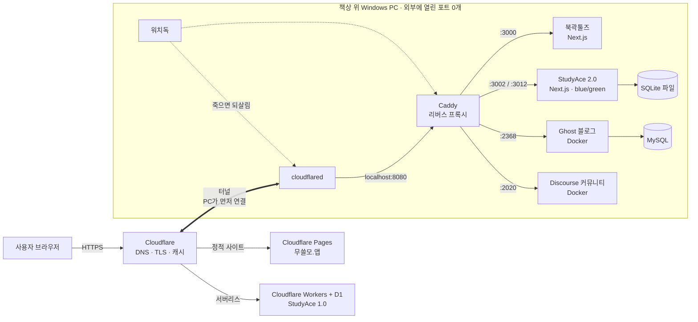

# 세미나 내용 문서 — 「localhost 에서 실서비스까지」

> `slides-draft.md` 의 짝 문서다. 슬라이드에 다 못 넣는 설명, 그림 원본, 코드 발췌, 사례 원문, 실습 가이드, 예상 질문을 모았다.
> 근거는 `seminar-context1.md`(BinaryHub 전체)와 `seminar-context3.md`(StudyAce, 검증판)다. `seminar-context2.md` 는 3의 이전 판이라 쓰지 않았다.
>
> **마스킹 규칙:** 터널 ID, 계정 정보, 이메일, 광고·분석 ID, 실제 IP, 비밀 값은 `<…>` 로 가렸다. Windows 사용자 경로는 `<USER>` 로 바꿨다. 공개 도메인 `binaryhub.club` 과 `localhost` 포트 번호는 구조 설명에 필요하고 비밀이 아니라서 그대로 두었다.
> 🔒 표시는 운영자가 공개하지 말라고 한 내용(북곽툴즈 문서 변환의 내부 동작 등)에 닿는 곳이다. 발표에서는 표시된 수준까지만 말한다.

---

## 목차

1. 초급 청중을 위한 용어 사전
2. 전체 구성도
3. 요청 하나가 지나가는 길
4. 기술 스택과 고른 이유
5. 사례 카드 (슬라이드 순서)
6. 설정·코드 발췌
7. 실습 가이드 (청중 배포용)
8. 데모 준비 체크리스트
9. 예상 질문과 답변 초안
10. 발표 전에 확인할 것

---

## 1. 초급 청중을 위한 용어 사전

슬라이드 하단이나 부록 장에 넣어도 되고, 실습 자료와 같이 나눠 줘도 된다.

| 용어 | 한 줄 설명 | 비유 |
|---|---|---|
| **서버** | 특정 포트에서 요청을 기다렸다가 응답하는 프로그램 | 가게 문 열고 손님을 기다리는 점원 |
| **포트** | 한 컴퓨터 안에서 프로그램을 구분하는 번호 (0~65535) | 건물의 호수 |
| **localhost** | "바로 이 컴퓨터". `127.0.0.1` 과 같다 | "우리 집" |
| **IP 주소** | 네트워크에서 기기를 찾는 주소 | 건물 주소 |
| **사설 IP / 공인 IP** | 공유기 안에서만 통하는 주소 / 인터넷 전체에서 통하는 주소 | 건물 안 호수 / 건물의 도로명 주소 |
| **NAT** | 공유기 안의 여러 기기가 공인 IP 하나를 나눠 쓰는 방식 | 경비실이 우편물을 호수별로 나눠 줌 |
| **포트포워딩** | "이 포트로 온 건 이 기기로 보내라"고 공유기에 정해 두는 것 | 경비실에 "택배는 801호로" 미리 말해 두기 |
| **도메인** | 사람이 외우기 쉬운 이름 (`binaryhub.club`) | 가게 이름 |
| **DNS** | 도메인 → IP 주소를 알려 주는 시스템 | 전화번호부 |
| **등록기관 / 네임서버** | 도메인을 사는 곳 / 그 도메인의 전화번호부를 관리하는 곳 | 이름의 주인 / 번호부 관리인 |
| **HTTPS / TLS** | 주고받는 내용을 암호화하는 방식. 인증서가 필요하다 | 봉인된 편지 |
| **CDN** | 전 세계에 흩어진 서버가 파일을 대신 보관했다가 가까운 곳에서 주는 서비스 | 동네마다 있는 물류 창고 |
| **터널** | 내 PC가 바깥으로 먼저 열어 둔 연결. 요청이 그 연결을 타고 거꾸로 들어온다 | 내가 먼저 건 전화로 상대가 말하는 것 |
| **리버스 프록시** | 요청을 받아서 알맞은 앱에 넘겨주는 중간 서버 | 건물 안내 데스크 |
| **프로세스 매니저 (PM2)** | 앱이 죽으면 다시 켜 주고, 재부팅 뒤 되살려 주는 도구 | 당직 근무자 |
| **배포** | 새 코드를 실제 서비스에 반영하는 일 | 새 메뉴판으로 바꿔 걸기 |
| **blue/green 배포** | 새 버전을 옆에 따로 띄워 두고 연결만 한 번에 바꾸는 방식 | 새 매장을 옆에 차려 놓고 간판 화살표만 돌리기 |
| **롤백** | 문제가 생겼을 때 이전 버전으로 되돌리는 것 | 화살표를 다시 원래 매장으로 |
| **마이그레이션** | DB 구조(표, 열, 인덱스)를 바꾸는 작업 | 창고 선반 배치 바꾸기 (되돌리기 어렵다) |
| **CI** | 코드를 올릴 때마다 깨끗한 환경에서 자동으로 빌드·테스트하는 것 | 매번 새 주방에서 같은 레시피로 시식 |
| **워치독** | 주기적으로 상태를 확인하고 죽은 걸 되살리는 감시 프로그램 | 순찰 경비원 |
| **530 / 1033** | Cloudflare까지는 왔는데 터널 반대편(내 PC)에 닿지 못했다는 오류 | 전화를 걸었는데 상대 전화기가 꺼져 있음 |

---

## 2. 전체 구성도

### 2-1. 발표용 단순판 (S14)

PPT에 넣을 때는 mermaid를 이미지로 변환하거나(예: mermaid.live에서 PNG로 내보내기) 도형으로 다시 그린다.



### 2-2. 상세판 (질문 대비, 발표자 참고용)

| 구성 요소 | 하는 일 | 듣는 곳 | 관리 방식 |
|---|---|---|---|
| Cloudflare | DNS, TLS 종료, 정적 파일 캐시, Pages·Workers 호스팅 | 인터넷 | 무료 플랜 |
| cloudflared | PC → Cloudflare 바깥 방향 터널. 받은 요청을 `localhost:8080` 으로 | (포트를 열지 않음) | 워치독 |
| Caddy | Host·경로로 앱 선택, http→https 301, JSON 접근 로그 | `:8080` (평문, PC 안에서만) | 워치독 |
| 북곽툴즈 | Next.js. 문서 변환 등 도구 모음. DB 없음 🔒 | `:3000` / `:3010` | PM2, blue/green |
| 옛 포털 앱 | 부원 블로그, 옛 글, 로그인 | `:3001` / `:3011` | PM2, blue/green |
| StudyAce 2.0 | Next.js + SQLite. 화면과 API가 한 프로세스 | `:3002` / `:3012` | PM2, blue/green |
| Ghost + MySQL | 동아리 블로그 | `127.0.0.1:2368` | Docker, `restart: unless-stopped` |
| Discourse | 커뮤니티 포럼 | `:2020` | Docker (공식 이미지) |
| PM2 | Node 앱 재시작, 메모리 1GB 넘으면 재시작, 예약 작업 | — | 로그온 때 자동 복원 |
| 워치독 | Caddy·cloudflared·Docker가 죽었으면 되살림 | — | 작업 스케줄러 5분 + 로그온 30초 뒤 |

---

## 3. 요청 하나가 지나가는 길

예: 학생이 StudyAce에서 답을 제출한다 → `POST https://binaryhub.club/studyace/api/study/answer`

1. **브라우저 → DNS:** `binaryhub.club` 을 물어보면 Cloudflare 서버 주소가 나온다. 내 PC 주소는 어디에도 안 나온다.
2. **브라우저 → Cloudflare:** HTTPS 연결이 Cloudflare에서 끝난다(TLS 종료).
3. **Cloudflare → 터널:** 이 도메인은 터널에 연결돼 있으므로, cloudflared가 미리 열어 둔 연결로 요청을 내려보낸다. 이때 원래 손님 IP(`CF-Connecting-IP`)와 원래 프로토콜(`X-Forwarded-Proto`)을 헤더에 붙인다.
4. **cloudflared → Caddy:** 설정대로 `http://localhost:8080` 에 넘긴다.
5. **Caddy:**
   - `X-Forwarded-Proto` 가 `http` 면 https 주소로 301을 보내고 끝낸다.
   - 도메인이 `binaryhub.club` 이고 경로가 `/studyace` 로 시작하면 지금 라이브인 슬롯(`:3002`)으로 넘긴다.
   - 접근 로그에 한 줄 남긴다(경로, 상태 코드, 처리 시간).
6. **StudyAce (Next.js):**
   - 세션 쿠키를 DB의 세션 표와 대조한다.
   - 속도 제한을 확인한다(계정당 1분 90회, 1시간 3000회).
   - **서버가 직접 채점**하고, 포인트와 다음 복습일을 한 트랜잭션으로 기록한다.
7. **응답:** 같은 길을 거꾸로 돌아간다.

정적 파일(`/_next/static/...`)은 Cloudflare가 캐시해서 두 번째부터는 PC까지 오지 않는다.

---

## 4. 기술 스택과 고른 이유

### 4-1. 레이어별 스택

| 레이어 | 쓰는 것 | 고른 이유 / 트레이드오프 |
|---|---|---|
| 프론트 + 서버 | Next.js 16 (App Router), React 19, TypeScript, Tailwind 4 | 서버 렌더링(검색 노출)과 API를 한 앱에. 세 앱이 같은 스택이라 배포 방식도 같다 |
| 블로그 | Ghost 5 (Docker + MySQL 8) | 회원, 뉴스레터, 댓글을 기본 제공. 직접 만든 마크다운 블로그에서 2026-09에 옮김 |
| 포럼 | Discourse (공식 Docker) | 직접 만들지 않고 검증된 오픈소스 |
| DB | StudyAce: SQLite (better-sqlite3 + Drizzle) | 아래 4-3 |
| 인증 | StudyAce: DB 세션 + httpOnly 쿠키 | 아래 4-4 |
| 프록시 | Caddy | 설정이 짧고, `caddy reload` 로 끊김 없이 반영 |
| 터널 | Cloudflare Tunnel | 공인 IP·포트포워딩 없이 공개, IP 비노출, 인증서 자동 |
| 프로세스 | PM2 | 자동 재시작, 메모리 상한, 재부팅 후 복원, 예약 작업(cron) |
| 백업 | StudyAce: `VACUUM INTO` 매일 04:00, 14개 보관 / 부원 글: 매일 비공개 git 레포로 | 백업이 아직 같은 디스크에 있다는 약점이 있다 |
| 모니터링 | Caddy JSON 접근 로그, 워치독 로그, Cloudflare Web Analytics, GA | **외부 업타임 알림 없음.** 장애를 사람이 먼저 알아챈 적이 있다 |
| CI/CD | 없음 (수동 배포 스크립트) | 사례 13 참고 |
| 개발 방식 | 대부분 Claude Code 세션으로 개발. 인수인계 문서(`HANDOFF.md`, 약 2,000줄)로 세션 사이 맥락 유지 | 질문이 나오면 쓸 이야깃거리 |

### 4-2. 사이트마다 호스팅을 다르게 고른 기준 (S15)

| 사이트 성격 | 고른 곳 | 이유 |
|---|---|---|
| 정적·읽기 전용 (무쓸모.앱) | Cloudflare Pages | API, 저장, 비밀 값이 없다. 대역폭 무제한, PC 메모리 약 250MB 회수 (2026-06 이전) |
| API + 엣지 DB (StudyAce 1.0) | Cloudflare Workers + D1 | 처음부터 그렇게 만들어져 있었다 |
| 서버 렌더링 + 저장 + 비밀 값 (북곽툴즈, 포털, StudyAce 2.0) | 집 PC + PM2 + 터널 | 외부 이전 시 글 반영 지연, 저장 구조 재설계, 비밀 값 분산 등 부담. 🔒 북곽툴즈에는 Windows가 필요한 기능이 있어 서버리스·컨테이너로 옮길 수 없다 |

**검토했다가 안 쓴 것:** Appwrite. 학생 무료 플랜 약관이 비상업용이라 광고(AdSense)와 맞지 않았다.

**다시 검토할 조건 (운영 기록):** 부원 수가 급증해 글·업로드가 폭증할 때, 운영 PC가 실제로 고장 났을 때, 변환 사용량이 크게 줄었을 때.

### 4-3. 결정: Workers + D1 → 집 PC + SQLite (S16)

- **원래 구조(1.0):** Cloudflare Worker + D1. PC와 상관없이 항상 떠 있고, D1이 30일 백업을 해 준다. 다만 클라이언트가 점수를 통째로 들고 서버에 덮어쓰는 구조라 충돌 처리, 부정 방지 휴리스틱, 점수 계산이 양쪽에 두 벌 있는 부채가 쌓여 있었다.
- **AI의 첫 의견:** "PC로 옮기면 PC가 꺼질 때 서비스도 죽고 백업이 수동이 된다. 가용성이 후퇴한다. Workers에 두고 내부만 새로 쓰자."
- **반론:** Workers 무료 플랜은 요청당 CPU 10ms. 통계 집계나 일괄 재계산을 붙이면 바로 천장에 닿는다.
- **결론:** PC로 옮긴다. 대신 **자동 백업을 의무로** 넣는다.
- **함께 얻은 것:** 옛 Worker 라우트가 경로를 잡고 있던 문제 해소, API가 같은 출처라 CORS 없음, 요청 수 한도 탈출, 관리자 페이지를 같은 앱에서 바로.
- **치른 대가 (지금도 유효):** PC와 망이 단일 장애점(6부 장애들), 백업 직접 책임, 백업이 같은 디스크에 있음.
- **구조 변화:** "서버가 단독으로 판정한다." 클라이언트는 "이 문항을 몇 초 걸려 이렇게 풀었다"는 사실만 보내고, 정답 판정·포인트·복습일은 서버가 정한다. 학습 기록은 추가만 하는 로그, 포인트는 원장(잔액 = 합계).

> 💬 발표 포인트: AI가 틀린 게 아니다. 가용성 지적은 맞았고, 실제로 6부에서 그 대가를 치렀다. 중요한 건 **잃는 것을 알고 고르고, 메울 장치를 같이 넣는 것**.

### 4-4. 결정: JWT 대신 DB 세션 쿠키 (질문 대비)

1. **즉시 끊을 수 있다:** JWT는 만료 전까지 막을 수 없다. 관리자가 계정을 정지해도 토큰이 살아 있다. DB 세션은 행을 지우면 바로 끊긴다.
2. **스크립트가 못 훔친다:** localStorage와 달리 httpOnly 쿠키는 JavaScript가 읽을 수 없다(XSS 대비).
3. 이게 가능했던 건 API가 화면과 **같은 출처**였기 때문이다. 다른 도메인이었다면 쿠키 제약 때문에 어려웠다.

---

## 5. 사례 카드

슬라이드 순서대로 정리했다. 각 카드는 **증상 → 원인 → 해결 → 교훈** 순서다. 날짜는 2026년.

### 카드 A. http 와 https 가 둘 다 200 (S10) — 09-18
- **증상:** Google Search Console에 `http://binaryhub.club/` 이 따로 잡혔다. 확인해 보니 네 도메인 모두 평문 http로도 사이트 전체가 열렸다.
- **원인:** Cloudflare가 http 요청도 그대로 터널로 내려보냈다. PC 안의 Caddy는 원래 평문이라 둘을 구분하지 않았다.
- **해결:** 접근 로그에서 Cloudflare가 `X-Forwarded-Proto` 헤더를 넘겨준다는 걸 확인 → Caddy에서 이 값이 `http` 면 https로 301. 헤더가 없는 PC 안의 상태 확인 요청은 그대로 통과하게 했다.
- **교훈:** TLS를 앞단에 맡기면, 뒤쪽 서버는 원래 프로토콜을 헤더로만 안다. 그리고 **로그를 켜 두어야** 이런 걸 볼 수 있다(이 사례 전날 접근 로그를 켰다).

### 카드 B. 슬래시 하나 차이로 404 (S13) — 08-25
- **증상:** `binaryhub.club/studyace` 가 블로그 앱의 404로 갔다.
- **원인:** Caddy 매처 `/studyace/*` 는 슬래시 없는 `/studyace` 를 잡지 못한다. 그 요청이 기본 규칙으로 새어 블로그 앱으로 갔다.
- **해결:** `path /studyace /studyace/*` 로 둘 다 적는다.
- **교훈:** 옛 라우트를 걷기 **전에** Host 헤더를 넣은 curl로 프록시를 먼저 시험했기 때문에 라이브가 깨지지 않았다.

### 카드 C. 한 도메인에 Next.js 앱 두 개 (S13) — 10-13
- **문제:** 루트 도메인을 북곽툴즈로 바꾸면서 옛 포털 앱(부원 블로그)도 같은 도메인의 일부 경로에 남겨야 했다. 그런데 두 앱 모두 정적 파일을 `/_next/` 로 부른다.
- **해결:** 옛 앱에 `assetPrefix: "/_bb"` → 그 앱은 `/_bb/_next/...` 를 부르고, Caddy가 `/_bb` 를 떼어 그 앱으로 보낸다. 지정된 경로 목록만 옛 앱, 나머지는 북곽툴즈.
- **배포 순서도 설계:** Caddy에 `/_bb` 경로 먼저 추가(무해) → 옛 앱 배포 → 북곽툴즈 배포 → 마지막에 루트 전환. 끊김 0.
- **교훈:** 경로 충돌은 페이지 주소보다 **정적 파일, 이미지, 로그인 콜백 같은 숨은 경로**에서 난다.

### 카드 D. 속도 제한, 쓰기 증폭, 포인트 파밍 (S17) — 09-02
- **증상:** 학생들이 "익스플로잇"을 공언했다. 확인해 보니 가짜 문항 30개로 310포인트를 0.1초 만에 벌 수 있었다.
- **원인:** 정답 여부를 클라이언트가 보낸 값으로 믿었고, 문항 ID도 검증하지 않았다.
- **해결 1:** 서버 채점 결과만 기록, 문항 존재·상태 검증 등 독립된 여러 겹의 방어.
- **2차 구멍:** 막으며 넣은 방어가 새 구멍이 됐다. 거절된 요청이 매번 감사 로그를 DB에 썼고, 속도 제한은 "성공"만 셌다. 스크립트로 두드리면 SQLite 쓰기 잠금 때문에 **다른 학생 화면이 멈출** 수 있었다.
- **해결 2:** 속도 제한이 "시도"를 센다. **막을 때는 DB에 아무것도 안 쓴다.**
- **교훈:** 클라이언트가 보낸 "결과"를 믿지 않는다. SQLite는 쓰기가 한 번에 하나라 **쓰기 횟수 자체가 공격면**이다.

### 카드 E. 마이그레이션 없이 코드만 배포 (S19) — 09-11
- **증상:** 연속 정답 보너스의 지급 상한이 사라졌다. 한 문항에 275포인트까지 나갈 수 있는 상태였다. 실제 지급은 0건(운).
- **원인:** 상한을 DB의 유니크 인덱스로 구현했는데, 마이그레이션 없이 코드만 배포됐다. 문서에는 "인덱스 5개 적용"이라고 돼 있었지만 실제 DB에는 4개였다.
- **해결:** 마이그레이션 적용. 배포 절차에 "적용된 마이그레이션 수 = 마이그레이션 파일 수"를 **DB에 직접 묻는** 확인을 넣었다.
- **교훈:** "돌렸다"가 아니라 "들어갔다"를 확인한다. 안전장치가 DB에 있으면, DB에 없을 때 코드가 맞아도 소용없다.

### 카드 F. `next build` 는 커밋이 아니라 작업 폴더를 빌드한다 (S19)
- **증상:** 커밋하지 않은 실험 코드 수백 줄이 빌드에 섞여 라이브로 나갈 뻔했다.
- **해결:** 배포 전에 `git stash` 로 빼고 빌드한 뒤 되돌린다.
- **교훈:** CI가 없으면 "깨끗한 체크아웃에서 빌드"가 보장되지 않는다. **CI가 왜 필요한지 보여 주는 가장 쉬운 예.**

### 카드 G. 알림이 두 번 갈 뻔함 (S19) — 설계 단계
- **위험:** 저녁 알림 타이머를 앱 안에 두면, 배포 직후(그리고 롤백용으로 옛 슬롯을 켜 두는 동안) blue와 green이 **둘 다** 보낸다.
- **해결:** 알림은 앱 밖의 예약 작업(PM2 cron) 하나만 보낸다.
- **교훈:** 같은 앱을 여러 벌 띄우면 "주기 작업"도 그만큼 복제된다. 앱 밖으로 뺀다.

### 카드 H. 장애 타임라인 (S20)

| 날짜 | 일 | 대응 |
|---|---|---|
| 08-25 | 개발 서버를 끄려고 `taskkill /IM node.exe /F` → 같은 PC의 운영 사이트도 502 | PM2로 재기동. 이후 포트로 PID를 찾아 그것만 끈다 |
| 09-08 | 재부팅 후 PM2·Docker는 자동 시작했지만 **Caddy·cloudflared는 자동 시작 등록이 없어서** 전 사이트 다운 | 수동 기동. "앱이 산다 ≠ 사이트가 산다" |
| 09-17 | 가동 219시간째(재부팅 아님)에 Caddy·cloudflared·Docker Desktop이 **동시에** 사라짐 → 네 사이트 모두 530 (Cloudflare 오류 1033). 다른 질문을 하다 우연히 발견 | 워치독 도입, 접근 로그 상설화. 원인은 아직 특정 못 함 |
| 10-06 14:59 | 워치독 로그에 셋 다 되살린 기록. 09-17과 같은 모양 | **사람이 알아채기 전에 복구됨.** 원인은 확인 필요 |
| 10-13 | PC가 35분 사이 여러 번 강제 종료됨(블루스크린 아님, 전원 버튼 기록 있음). 12:24 재부팅 → 직전 워치독 실행이 11:59라 다음 실행은 12:29 → 그 사이 사이트가 꺼진 채였고 **사람이 먼저 알아챔** | 로그온 30초 뒤 한 번 실행하는 시작프로그램 바로가기 추가 (로그온 트리거 예약 작업은 관리자 권한이 필요해 거부됨) |

- **교훈 1:** "부팅 시 시작"과 "죽으면 되살리기"는 다른 문제다.
- **교훈 2:** 주기 실행만으로는 부팅 직후가 반드시 빈다. 트리거는 **주기 + 이벤트** 둘 다 필요하다.
- **교훈 3:** 로그는 장애가 나기 **전에** 켜 둬야 쓸모 있다. 10-06처럼 아무도 몰랐던 장애는 워치독 로그에만 남는다.
- **남은 문제:** PC 자체가 멈추는 원인(하드웨어 의심)은 미해결. 단일 서버의 한계.

### 카드 I. "렉이 심하다" — 서버가 아니라 망 (S22) — 10-12
- **증상:** 학생들이 "칭호 화면 렉이 심하다"고 신고.
- **조사:**
  1. 프록시 접근 로그의 서버 처리 시간 중간값: 칭호 화면 12ms, 답 제출 16ms → 정상
  2. 공개 주소로 구간별 시간 측정: TCP 연결 12ms인데 **TLS 단계 1~4초**, 캐시된 파일 하나도 1~9초
  3. `https://binaryhub.club/cdn-cgi/trace` 의 `colo=SEA`. 학생들이 쓰는 망(KT)에서 Cloudflare 접속 지점이 **시애틀**로 잡혔다. 터널은 인천(ICN)에 붙어 있다 → 학생 → 시애틀 → 인천 → PC 왕복
  4. 다른 Cloudflare 무료 사이트도 같은 증상. 학교 방화벽 문제는 아니었다
- **해결:** 화면 쪽 완화(로딩 골격, 대기 표시, 요청 수 줄이기)만 했다. 근본 해결은 결정 대기 중. 유력한 안은 "서울 리전에 작은 클라우드 서버를 두고 PC와 사설망으로 잇기". Cloudflare 유료 플랜은 한국 통신사가 인천으로 보내 준다는 보장이 없어 권하지 않았다.
- **교훈:** 느리다는 신고가 오면 코드보다 먼저 ① 서버 처리 시간 ② 공개 주소의 TLS/TTFB ③ CDN 접속 지점을 본다. 무료 CDN이 가까운 곳으로 보내 준다는 보장은 없다.

### 카드 J. 속도 제한이 성실한 학생을 막음 (S23) — 09월 ~ 10-07
- **배경:** 카드 D 이후 SQLite 쓰기 잠금을 지키려고 계정당 속도 제한을 걸었다.
- **1차:** "1시간에 120번". 연속 정답 보너스가 생기자 아는 문항을 빠르게 도는 게 가장 효율적인 학습법이 됐다. 한 계정이 10분에 120번을 쓰고 **48분** 막혔다. 창이 미끄러지는 방식이라 가장 몰아친 사람이 가장 오래 막혔다.
- **2차:** "1분 40번 + 1시간 600번"으로 나눔. 그런데 영단어에 숫자 키·엔터 단축키를 넣자 사람도 1초 남짓에 하나씩 풀게 됐고, 한 학생이 한 시간에 **정확히 600번**을 채우고 "18분 뒤 다시 시도"를 받았다.
- **지금:** "1분 90번 + 1시간 3000번". 3000은 1.2초에 하나씩 한 시간을 쉬지 않아야 닿는 수다. 스크립트는 초당 수십 번을 보내므로 여전히 1초 안에 걸린다.
- **교훈:** 제한 숫자의 기준은 "공격자 속도"가 아니라 **"가장 빠른 정상 사용자 속도"**. 기능 변경(단축키)이 운영 설정을 깬다. 같은 학교 학생들이 공인 IP 하나를 나눠 쓰므로 IP 기준 한도는 계정 기준보다 훨씬 느슨하게 잡았다.

### 슬라이드에 안 넣은 사례 (질문이 나오면)

| 사례 | 한 줄 요약 | 교훈 |
|---|---|---|
| CSP가 PDF 기능을 조용히 멈춤 | pdf.js 워커를 CDN에서 불렀는데 보안 헤더(CSP)가 막음 → 에러 없이 무한 대기. 워커 파일을 같은 출처로 옮겨 해결 | 보안 헤더는 기능 동작을 바꾼다 |
| CDN 캐시에 속은 배포 확인 | 전환 후에도 공개 주소에서 옛 빌드 파일이 200 (Cloudflare 캐시). 옛 빌드의 404는 CDN을 건너뛰고 PC에 직접 물어 확인 | CDN 뒤에서는 "누가 응답했나"를 구분 |
| "robots.txt는 Worker가 응답한다"는 메모가 틀림 | 응답 헤더(`via: Caddy` 등)를 보니 실제론 PC의 앱이 응답 | 어디서 응답하는지는 기억 말고 헤더로 확인 |
| Cloudflare가 robots.txt에 비표준 줄을 끼워 넣음 | "Managed robots.txt" 기능 때문에 AdSense가 ads.txt를 못 읽음. 기능을 끄고 AI 크롤러 차단은 나중에 표준 문법으로 다시 넣기로 | 편의 기능이 다른 서비스와 충돌할 수 있다 |
| Next 16이 `NEXT_DIST_DIR` 을 더 안 읽음 | blue와 green이 같은 빌드 폴더를 덮어쓸 수 있는 상태였다. `next.config.ts` 에서 직접 받아 해결 | 메이저 업그레이드는 배포 스크립트의 전제를 조용히 깬다 |
| 빈 DB로 뜬 시험 서버 | git-bash 경로가 Windows 경로로 바뀌고, SQLite는 없는 파일을 열면 빈 DB를 만든다 | "서버가 떴다" ≠ "맞는 DB를 보고 있다" |
| WAL DB를 `cp` 로 백업 | 커밋 중인 트랜잭션이 잘린 깨진 백업. `VACUUM INTO` 로 백업 | DB 백업은 DB에게 시킨다 |
| 빌드 산출물에 교과서 원본과 DB가 따라 들어갈 뻔 | Next 파일 추적이 폴더 전체를 산출물에 넣음. 제외 설정으로 해결 | 컨테이너로 가는 순간 이미지에 비공개 데이터가 박힌다 |
| Windows 셸 함정 | PowerShell 5.1은 BOM 없는 UTF-8을 ANSI로 읽어 한글이 깨짐, `Set-Content` 기본 인코딩이 cp949, `.cmd` 는 ASCII+CRLF로 | 운영 서버 OS의 특성도 배포의 일부 |
| `.wrangler/` 캐시가 커밋될 뻔 | Cloudflare 계정 ID와 이메일이 들어 있었다. 푸시 전에 발견해 gitignore | 비밀은 도구 캐시에도 숨어 있다 |
| 주석이 실제와 달랐다 | Caddyfile 주석은 "green"인데 포트는 blue. 주석에 "deploy.ps1이 한다"고 적혀 있지만 실제 스크립트 목록에는 없음 | 손 배포에서는 주석과 문서도 배포 대상 |

---

## 6. 설정·코드 발췌

모두 마스킹하고 축약했다. 원본을 화면에 띄우지 말고 이 발췌본을 쓴다.

### 6-1. cloudflared `config.yml` (S9)

```yaml
tunnel: <TUNNEL-ID>
credentials-file: 'C:\Users\<USER>\.cloudflared\<TUNNEL-ID>.json'   # 비밀 파일. 절대 공개 금지

ingress:
  - hostname: tools.binaryhub.club          # 옛 주소. 지금은 루트로 301
    service: http://localhost:8080
  - hostname: binaryhub.club
    service: http://localhost:8080
  - hostname: community.binaryhub.club
    service: http://localhost:8080
  - hostname: blog.binaryhub.club
    service: http://localhost:8080
  - service: http_status:404                # 마지막 규칙은 필수 (목록에 없는 호스트)
```

**설계 포인트:** 도메인이 몇 개든 전부 Caddy 한 곳으로 보낸다. 터널 설정은 거의 안 바뀌고, 배포 때 바뀌는 건 Caddyfile뿐이다.

### 6-2. Caddyfile 핵심부 (S12)

```caddy
{
	admin localhost:2019
	auto_https off                # TLS는 Cloudflare가 한다
}
:8080 {
	log {
		output file <REPO>/logs/caddy-access.log {
			roll_size 20MiB
			roll_keep 10
		}
		format json
	}
	# Cloudflare가 http 요청도 그대로 넘기므로 여기서 https로 보낸다
	@insecure header X-Forwarded-Proto http
	handle @insecure {
		redir https://{host}{uri} permanent
	}
	@root host binaryhub.club
	handle @root {
		handle /_bb/* {                         # 옛 포털 앱의 정적 파일
			uri strip_prefix /_bb
			reverse_proxy localhost:3001
		}
		@studyace path /studyace /studyace/*
		handle @studyace {
			reverse_proxy localhost:3002        # blue=3002 / green=3012. 배포 때 이 줄만 바뀐다
		}
		@portal path /club /club/* /blog /blog/* /uploads/* /api/auth/*
		handle @portal {
			reverse_proxy localhost:3001
		}
		handle {
			reverse_proxy localhost:3000        # 나머지 = 북곽툴즈
		}
	}
	# blog. / community. 호스트 블록 생략
}
```

### 6-3. PM2 blue/green 정의 (S18)

```js
const slot = (name, port, distDir) => ({
  name: `studyace-${name}`,
  script: "./node_modules/next/dist/bin/next",
  args: `start -p ${port}`,
  env: {
    NODE_ENV: "production",
    NEXT_DIST_DIR: distDir,                 // 슬롯마다 빌드 폴더를 따로
    STUDYACE_DB_PATH: "<ABS-PATH>/data/studyace.db",  // 절대경로: 두 슬롯이 같은 DB를 보게
  },
  autorestart: true,
  max_memory_restart: "1G",
});

module.exports = {
  apps: [
    slot("blue", 3002, ".next-blue"),
    slot("green", 3012, ".next-green"),
    { name: "studyace-backup", script: "scripts/backup-db.mts",
      autorestart: false, cron_restart: "0 4 * * *" },     // 매일 04:00 백업
    { name: "studyace-notify", script: "scripts/notify.mts",
      autorestart: false, cron_restart: "0 21 * * *" },    // 알림 발송자는 이것 하나
  ],
};
```

### 6-4. 배포 스크립트: 전환과 자동 롤백 (S18)

```powershell
# 1) 대기 슬롯에 빌드. 실패하면 라이브는 그대로 두고 끝
# 2) 대기 슬롯 재시작 → localhost:<대기포트> 가 응답할 때까지 최대 60초 대기
# 3) Caddyfile 포트 한 줄 교체 + reload
$newContent = $caddyContent -replace "reverse_proxy localhost:$activePort\b", "reverse_proxy localhost:$targetPort"
Set-Content -Path $caddyfile -Value $newContent -NoNewline -Encoding utf8
cmd /c "`"$caddyExe`" reload --config `"$caddyfile`" 2>&1" | Out-Null
if ($LASTEXITCODE -ne 0) {
    Set-Content -Path $caddyfile -Value $caddyContent -NoNewline -Encoding utf8   # 원래대로
    cmd /c "`"$caddyExe`" reload --config `"$caddyfile`" 2>&1" | Out-Null
    Write-Error "Caddy reload 실패. Caddyfile 롤백."; exit 1
}
# 4) 옛 슬롯은 지우지 않고 멈추기만 한다 → 되돌릴 수 있다
pm2 stop $activeApp | Out-Null
```

StudyAce는 마이그레이션 시점을 사람이 정해야 해서 이 스크립트 대신 손으로 같은 순서를 밟는다: **DB 백업 → 대기 슬롯 빌드 → (전환 직전) 마이그레이션 → 대기 슬롯 직접 확인 → Caddy 전환 → 공개 주소로 새 빌드 ID 확인 → 기록.**

### 6-5. 워치독 (S21)

```powershell
# Caddy: 프로세스가 있어도 :8080 이 안 열려 있으면 죽은 것으로 본다
$port = Get-NetTCPConnection -LocalPort 8080 -State Listen -ErrorAction SilentlyContinue
if (-not $port) {
    & $caddyExe validate --config $caddyfile 2>&1 | Out-Null
    if ($LASTEXITCODE -eq 0) {                       # 깨진 설정이면 재시작하지 않는다
        Start-Process -FilePath $caddyExe -ArgumentList @("run","--config",$caddyfile) -WindowStyle Hidden
    } else { Say "Caddyfile 이 유효하지 않아 시작하지 않음 - 사람이 봐야 함" }
}
# cloudflared: 없으면 전부 530
if (-not (Get-Process cloudflared -ErrorAction SilentlyContinue)) {
    Say "cloudflared 죽어 있음 - 재시작"
    Start-Process -FilePath $cfExe -ArgumentList @("tunnel","--config",$cfConfig,"run") -WindowStyle Hidden
}
# Docker: docker ps 가 실패하면 Docker Desktop 실행
```

등록: 작업 스케줄러 `schtasks /SC MINUTE /MO 5` (5분마다) + 시작프로그램 바로가기 (로그온 30초 뒤 한 번).

### 6-6. SQLite 연결 설정 (S17)

```ts
const sqlite = new Database(DB_PATH);
sqlite.pragma("journal_mode = WAL");    // 읽기가 쓰기를 막지 않는다. 두 슬롯이 같은 파일을 연다
sqlite.pragma("foreign_keys = ON");     // SQLite는 기본이 꺼짐. 켜야 CASCADE가 동작
sqlite.pragma("busy_timeout = 5000");   // 쓰기 잠금을 만나면 즉시 실패하지 말고 5초 기다림
```

### 6-7. 프록시 뒤에서 손님 IP 읽기 (질문 대비)

```ts
// Cloudflare → cloudflared → Caddy. Cloudflare가 CF-Connecting-IP를, Caddy가 X-Forwarded-For를 붙인다.
// 둘 다 위조할 수 있는 값이라 IP는 안전망일 뿐이고, 실제 차단은 계정 축이 한다.
export function clientIp(request: Request): string {
  const cf = request.headers.get("cf-connecting-ip");
  if (cf) return cf.trim();
  const xff = request.headers.get("x-forwarded-for");
  if (xff) return xff.split(",")[0]!.trim();
  return "unknown";
}
```

### 6-8. Ghost compose: localhost에만 열기 (질문 대비)

```yaml
services:
  ghost:
    image: ghost:5-alpine
    restart: unless-stopped
    ports:
      - "127.0.0.1:2368:2368"       # localhost에만. 외부는 터널로만 들어온다
    environment:
      url: https://blog.binaryhub.club
      database__client: mysql
      database__connection__host: mysql                       # compose 네트워크의 서비스 이름
      database__connection__password: ${MYSQL_GHOST_PASSWORD} # .env에서 주입
    depends_on:
      mysql:
        condition: service_healthy  # DB가 준비된 뒤에 뜬다
  mysql:
    image: mysql:8
    restart: unless-stopped
```

---

## 7. 실습 가이드 (청중 배포용)

> 이 절만 따로 떼어 동아리 블로그나 공유 폴더에 올리면 된다.
> 명령은 각 도구의 일반 사용법이다. 버전이 바뀌면 공식 문서를 한 번 확인할 것.

### 실습 1. 5분 만에 내 컴퓨터를 인터넷에 공개하기 (계정 불필요)

**준비물:** 파이썬이 깔린 컴퓨터

```bash
# 1) cloudflared 설치
winget install --id Cloudflare.cloudflared      # Windows
brew install cloudflared                        # macOS

# 2) 아무 폴더에서 간단한 서버 띄우기
python -m http.server 8000
#    → 브라우저에서 http://localhost:8000 이 열리는지 확인

# 3) 새 터미널을 열고 임시 터널 만들기
cloudflared tunnel --url http://localhost:8000
#    → 출력에 https://<랜덤>.trycloudflare.com 이 나온다
```

**해 볼 것**
- 휴대폰 LTE(와이파이 끄고)로 그 주소에 들어가 본다.
- 주소가 `https` 인 걸 확인한다. 인증서를 만든 적이 없는데도.
- 터미널 3을 `Ctrl+C` 로 끄고 새로고침해 본다. → 이게 "프로세스 관리"가 필요한 이유.

**주의:** 임시 주소는 실행할 때마다 바뀐다. 시험용으로만 쓴다. 이 주소를 아는 사람은 누구나 그 폴더의 파일을 볼 수 있으니 **비밀 파일이 있는 폴더에서 하지 말 것.**

### 실습 2. 내 도메인에 고정 연결하기 (도메인이 있는 사람)

**준비:** Cloudflare 계정 + 네임서버를 Cloudflare로 옮긴 도메인 (반영에 몇 분 ~ 몇 시간 걸린다)

```bash
cloudflared tunnel login                              # 브라우저에서 도메인 선택 → 인증서 저장
cloudflared tunnel create demo                        # 터널과 자격 증명 JSON 생성 (비밀! git 금지)
cloudflared tunnel route dns demo app.example.com     # 도메인 → 터널 연결 (DNS 레코드 생성)
```

`~/.cloudflared/config.yml`:
```yaml
tunnel: <TUNNEL-ID>
credentials-file: /home/<USER>/.cloudflared/<TUNNEL-ID>.json
ingress:
  - hostname: app.example.com
    service: http://localhost:8000
  - service: http_status:404
```

```bash
cloudflared tunnel ingress validate    # 설정 문법 확인
cloudflared tunnel run demo            # 실행
```

### 실습 3. 리버스 프록시로 앱 여러 개 + 무중단 교체 맛보기 (중급)

```caddy
# Caddyfile
{
	auto_https off
}
:8080 {
	handle /api/* {
		reverse_proxy localhost:3001
	}
	handle {
		reverse_proxy localhost:3000     # ← 3010으로 바꾸고 reload 하면 무중단 교체
	}
}
```

```bash
caddy run --config Caddyfile                         # 실행
# 새 버전을 3010에 띄운 뒤 Caddyfile의 3000 → 3010 으로 바꾸고:
caddy reload --config Caddyfile                      # 연결을 끊지 않고 설정만 바꾼다
curl -H "Host: app.example.com" http://localhost:8080/   # DNS 없이 프록시만 시험
```

### 실습 4. 꺼져도 다시 살아나게 (PM2)

```bash
npm i -g pm2
pm2 start "python -m http.server 8000" --name demo   # 아무 명령이나 관리할 수 있다
pm2 list                                             # 상태 보기
pm2 logs demo                                        # 로그 보기
pm2 save                                             # 지금 목록 저장
pm2 startup                                          # (Linux/macOS) 부팅 시 복원 등록
# Windows는 pm2-windows-startup 같은 별도 도구가 필요하다
```

### 실습 5. "느려요"를 재 보기

```bash
# 구간별 시간
curl -o /dev/null -s -w "connect %{time_connect}s  tls %{time_appconnect}s  ttfb %{time_starttransfer}s\n" https://<도메인>/
# Cloudflare가 어느 도시 접속 지점으로 보냈나
curl -s https://<도메인>/cdn-cgi/trace | grep colo
```
학교 와이파이와 휴대폰 핫스팟에서 각각 재서 비교해 보자.

### 절대 하지 말 것
- `~/.cloudflared/*.json`, `cert.pem`, `.env` 를 git에 올리기
- 비밀 값이 있는 폴더를 Quick Tunnel로 공개하기
- 운영 중인 PC에서 `taskkill /IM node.exe` 처럼 **이름으로 전부** 끄기

---

## 8. 데모 준비 체크리스트

### 장비
- [ ] **운영 PC가 아닌** 발표용 노트북 (운영 PC에서 데모하면 실제 서비스가 같이 죽을 수 있다. 카드 H의 08-25 사고)
- [ ] 노트북에 cloudflared, Python 설치
- [ ] (실습 3을 보여 줄 경우) Caddy, Node, PM2 설치
- [ ] 발표장 망에서 Quick Tunnel이 되는지 **전날 리허설** (학교망이 막을 수도 있다)
- [ ] 휴대폰 핫스팟을 예비 회선으로
- [ ] **망이 안 될 때 틀 녹화 영상** (Quick Tunnel 공개 → 폰 접속 → 터미널 종료 → 접속 실패)
- [ ] QR 코드 생성기 (터널 주소가 나오면 바로 화면에 QR로)

### 화면 정리
- [ ] 터미널 프롬프트와 경로에 사용자 이름이 안 보이게
- [ ] 브라우저 북마크·탭에 Cloudflare 대시보드, 계정 정보가 안 보이게
- [ ] 발표 중 알림 끄기

### 데모별 대본
| 데모 | 보여 줄 것 | 실패하면 |
|---|---|---|
| Quick Tunnel (S8) | 폰으로 접속 → 터미널 끄기 → 접속 실패 | 녹화 영상 |
| http→https (S10, 선택) | `curl -I http://binaryhub.club/` → `301` | 캡처 이미지 |
| 응답 출처 읽기 (선택) | `curl -I https://binaryhub.club/robots.txt` → `via: 1.1 Caddy`, `cf-cache-status` | 캡처 이미지 |
| colo 확인 (S22, 선택) | `/cdn-cgi/trace` 의 `colo` 값 | 당일 망에 따라 SEA가 안 나올 수 있다. 미리 찍은 캡처를 함께 준비 |

> 실서비스에 대고 하는 건 **읽기만 하는 curl** 까지. 터널을 죽이는 데모(530 재현)는 발표용 터널로만 한다.

---

## 9. 예상 질문과 답변 초안

**Q. 왜 Vercel 이나 AWS 에 안 올렸나요?**
A. 사이트마다 달라요. 정적 사이트는 실제로 Cloudflare Pages에 올렸어요. 집 PC에 둔 건 서버 렌더링, 로컬 파일 저장, 비밀 값이 다 필요한 앱들이고, Windows 환경이 필요한 기능도 있어요. 무료 서버리스는 실행 시간이나 CPU 제한이 있어서(Workers 무료는 요청당 CPU 10ms) 통계 집계 같은 걸 붙이면 바로 천장에 닿았어요. 대신 PC가 꺼지면 같이 꺼진다는 대가를 치르고 있어요.

**Q. ngrok 이랑 뭐가 달라요?**
A. 원리는 비슷해요. 둘 다 내 PC가 바깥으로 먼저 연결하는 방식이에요. 저는 이미 DNS를 Cloudflare에 맡기고 있었고, 무료로 내 도메인을 고정 연결할 수 있어서 Cloudflare Tunnel을 썼어요. *(세부 요금·제한은 시기마다 바뀌니 답할 때 단정하지 말 것)*

**Q. 터널이 해킹 통로가 되진 않나요?**
A. 터널은 설정에 적은 도메인을 적은 로컬 주소로만 넘겨요. 제 PC는 외부에 열린 포트가 0개라 오히려 공격면이 줄었어요. 다만 앱 자체의 보안(로그인, 속도 제한, 입력 검증)은 여전히 제 몫이에요. 그리고 터널 자격 증명 파일이 새면 누가 제 도메인으로 트래픽을 받아 갈 수 있으니 그 파일은 비밀로 관리해요.

**Q. 내 집 IP 가 드러나나요?**
A. 아니요. DNS를 조회하면 Cloudflare 주소가 나와요. 제 PC는 바깥으로 연결만 걸어요.

**Q. 전기세나 비용은요?**
A. Cloudflare는 무료 플랜을 써요. 고정 비용은 도메인 정도예요. *(도메인 연 비용과 전기 사용량은 발표자가 채워 넣을 것)*

**Q. Docker 는 왜 앱에는 안 썼어요?**
A. 블로그와 포럼처럼 남이 만든 서비스는 공식 Docker 이미지가 있어서 그걸 썼어요. 직접 만든 Next 앱은 PC에서 바로 돌리는 게 단순했어요. *(공식 기록이 없으니 발표자 본인의 이유로 답할 것)* 덧붙일 만한 함정: 컨테이너로 만들 때 빌드 산출물에 교과서 원본 PDF와 DB까지 따라 들어갈 뻔한 걸 발견해서 막아 뒀어요.

**Q. SQLite 로 정말 버티나요?**
A. 지금 규모(가입 86명, 주간 활성 28명, DB 약 8MB)에서는 충분해요. 다만 쓰기가 한 번에 하나라 쓰기를 남발하는 요청이 위험하고, 실제로 그걸 막느라 속도 제한을 여러 번 고쳤어요(카드 D, J).

**Q. 서버가 죽으면 어떻게 알아요?**
A. 솔직히 지금은 외부 알림이 없어요. 워치독이 되살리고 로그를 남기는데, 사람이 먼저 알아챈 적도 있어요. 다음 과제예요.

**Q. 백업은요?**
A. DB는 매일 새벽 4시에 백업해서 14개를 보관하고, 부원 글은 매일 비공개 git 레포로 올려요. 약점은 DB 백업이 같은 디스크에 있다는 거예요. 디스크가 죽으면 백업도 같이 죽어요. 이것도 다음 과제예요.

**Q. 이걸 혼자 다 했어요?**
A. 대부분 Claude Code로 개발했어요. AI 세션은 대화가 끝나면 맥락이 사라지니까, 인수인계 문서에 라이브 슬롯, 빌드 ID, 롤백 방법을 배포마다 적어요. AI가 틀린 판단을 할 때도 있어서(클라우드에 남자고 했던 것) 결정은 사람이 해요. *(발표자 본인 경험으로 보충)*

---

## 10. 발표 전에 확인할 것

### 10-1. 공개 범위 (발표자가 결정)
- [ ] 🔒 북곽툴즈 "Windows가 필요한 기능"을 어디까지 말할지 → 기본값: S15의 한 줄까지만
- [ ] 서버 PC가 어디(집/학교)에 있는지 밝힐지 → 기본값: "책상 위 PC"로만 표현. 슬라이드에서는 학교망을 **사용자 쪽** 이야기(S22, 시애틀)로만 언급
- [ ] 장애 사례(PC가 꺼지면 사이트가 죽는다)를 동아리 밖에도 공개할지 → 슬라이드를 외부에 공유한다면 다시 확인
- [ ] 사용자 수(86명 등) 공개해도 되는지

### 10-2. 자료끼리 어긋난 곳
- [ ] **Caddyfile이 git으로 관리되는가?** context1(사례 11)은 "2026-09-16에 git으로 추적 시작"이라고 하고, context3(4.5)은 "git으로 관리하지 않는다, `.bak` 파일이 bbb/에 34개, caddy-history/에 35개"라고 한다. 두 문서가 본 대상(모노레포 쪽 vs 라이브 파일)이 다를 수 있다. 이 문제가 정리될 때까지 슬라이드에서는 이 이야기를 뺐다.
- [ ] `ecosystem.config.js` 에는 Caddy·cloudflared가 PM2 앱으로 적혀 있지만 실제로는 워치독이 관리한다. 슬라이드는 실제 상태(워치독) 기준으로 썼다.

### 10-3. 근거가 없어 발표자가 채울 것
- [ ] Cloudflare Tunnel을 처음 고른 이유 (슬라이드는 일반적인 이유로 썼다)
- [ ] Ghost로 옮긴 이유, 앱을 컨테이너로 안 한 이유
- [ ] 도메인 비용, PC 사양, 전기 사용량
- [ ] Cloudflare SSL/TLS 모드, "Always Use HTTPS", Access 사용 여부 (질문이 나오면)
- [ ] 09-17, 10-06, 10-13 장애의 원인 (모름이면 "아직 모른다"가 정답이고, 그 자체가 S20의 메시지)

### 10-4. 화면에 절대 띄우지 말 것
- 터널 자격 증명 JSON, `cert.pem`, `.env`, 구글 API 클라이언트 시크릿 파일
- 원본 Caddyfile (광고 게시자 ID가 들어 있다) → 6-2 발췌본을 쓴다
- Cloudflare 대시보드의 계정·zone 정보
- 접근 로그의 실제 IP
- Windows 사용자 이름이 들어간 경로
